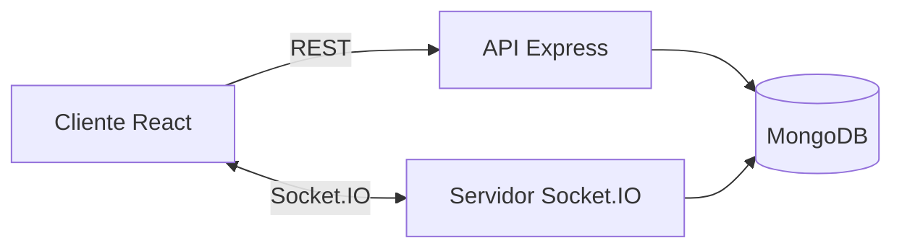

# Plan técnico — Título del feature

> **Qué es este documento:** traduce la spec en decisiones técnicas. Debe respetar la constitución y cubrir los requisitos de `spec.md`.

## 1. Contexto técnico

- Runtime: Node.js 20 LTS o superior.
- Base de datos: MongoDB 6+ con Mongoose.
- Backend: Express, Socket.IO, CORS, JWT, bcrypt.
- Frontend: React, Vite, Tailwind, React Router, Zustand, Axios, Socket.IO Client, `vite-plugin-pwa` (opcional).
- Pruebas: Vitest, Supertest, React Testing Library, Playwright.
- Entornos: desarrollo local y demo web responsive.

## 2. Constitution Check

| Principio | Cumple | Evidencia |
|---|---|---|
| 1. Spec-first y trazabilidad | Sí | Cada FR referencia su ID de spec y el PDF. |
| 2. Un solo registro, tres vistas | Sí | Servidor autoritativo y snapshots consistentes. |
| 3. FIFO y una sola acción de cocina | Sí | Sin “En preparación”, sin tiempos, solo “Marcar listo”. |
| 4. Control de raciones y agotados | Sí | Descuento atómico y ajustes auditados. |
| 5. Trazabilidad y cierre de turno | Sí | Responsables y resumen guardado. |
| 6. Web responsive y alcance acotado | Sí | Sin pagos, facturación, APK ni tiempos. |

## 3. Arquitectura



## 4. Estructura del proyecto

```text
client/
server/
shared/
```

## 5. Modelo de datos

Referencia a `001/data-model.md` o describe las colecciones que toca este feature.

## 6. Contratos

Referencia a `001/contracts/rest-api.md` o `005/contracts/events.md`.

## 7. Fases de implementación

1. Fase 0 — Preparación.
2. Fase 1 — Base compartida.
3. Fase 2 — Historia principal.
4. Fase 3 — Historias secundarias.
5. Fase 4 — Pruebas y pulido.

## 8. Estrategia de pruebas

- Unitarias: reglas de dominio y funciones puras.
- Integración: endpoints REST y eventos Socket.IO.
- E2E: flujo mozo → cocina → listo → entregado.
- Manual: guion de demo.

## 9. Riesgos y mitigaciones

| Riesgo | Impacto | Mitigación |
|---|---|---|
|  |  |  |

## 10. Complejidad / excepciones

Cualquier excepción a la constitución debe justificarse aquí.

## 11. Fuera de alcance

- Elemento excluido.

## 12. Checklist del plan

- [ ] Todos los FR de la spec están cubiertos.
- [ ] Constitution Check completo.
- [ ] Contratos definidos.
- [ ] Pruebas planificadas.
- [ ] Tareas derivables sin ambigüedad.
