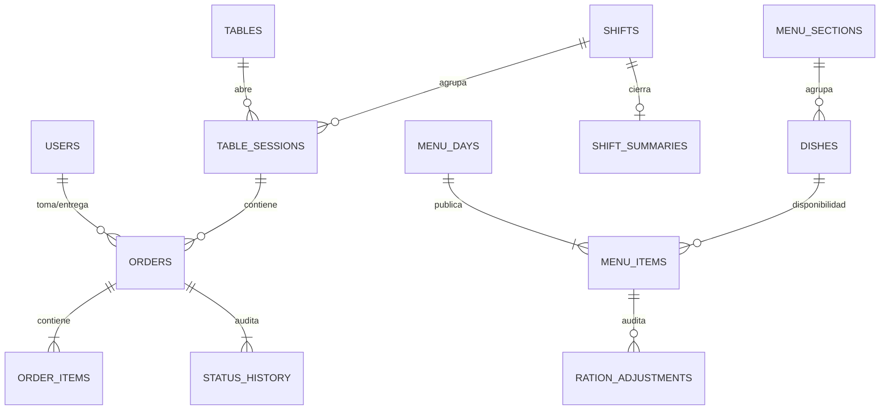

# Modelo de datos canónico — Cevichería Lucy v2

> Fuente de verdad para entidades, estados y reglas de persistencia. `002`, `003`, `004`, `005` y `006` deben referenciar este documento, no redefinirlo.

## 1. Decisiones de modelado

| Decisión | Elección | Motivo |
|---|---|---|
| Base de datos | MongoDB 6+ con Mongoose | Stack acordado. |
| Dinero | Enteros en céntimos (`priceCents`) | Evitar errores de coma flotante. Sin IGV. |
| Ítems del pedido | Embebidos en `orders.items[]` | Creación atómica de un solo documento; snapshot histórico. |
| Raciones | Documentos `menuItems` separados | Descuento atómico por plato y auditoría de ajustes. |
| Concurrencia de pedido | `version` + filtro por estado | Evitar dobles transiciones. |
| Concurrencia de raciones | `findOneAndUpdate` con `$gte` sobre `remainingRations` | Evitar sobreventa. |
| Numeración | `counters` con `findOneAndUpdate` atómico | Números legibles y únicos. |
| Borrador | Solo UI/local | El PDF lo describe como estado previo a cocina. |
| Mesas | `tableSessions` | Agrupar rondas y permitir cierre manual. |
| Turnos | `shifts` | P-06 cierra el turno y agrupa pedidos. |
| Menú | `menuDays` + `menuItems` | Menú del día publicado y disponibilidad/raciones. |
| Pagos | No se modelan | Fuera de alcance del PDF. |
| Fechas | ISO 8601 UTC; visualización `America/Lima` | Consistencia. |

## 2. Diagrama de entidades



## 3. Colecciones

### 3.1 `users`

| Campo | Tipo | Requerido | Notas |
|---|---|---|---|
| `_id` | ObjectId | Sí | PK. |
| `username` | string | Sí | Único, minúsculas. |
| `passwordHash` | string | Sí | bcrypt coste ≥ 10. |
| `displayName` | string | Sí | Nombre visible. |
| `role` | enum | Sí | `ENCARGADO`, `MOZO`, `COCINERO`. |
| `active` | boolean | Sí | Default `true`. |
| `lastLoginAt` | Date | No | Actualizado al login. |
| `createdAt` / `updatedAt` | Date | Sí | Timestamps. |

**Índices:** `{ username: 1 }` único; `{ role: 1, active: 1 }`.

### 3.2 `tables`

| Campo | Tipo | Requerido | Notas |
|---|---|---|---|
| `_id` | ObjectId | Sí | PK. |
| `code` | string | Sí | Único (`M01`, `M02`). |
| `zone` | string | No | Salón, Terraza, Barra. |
| `seats` | number | No | Capacidad estimada. |
| `active` | boolean | Sí | Default `true`. |
| `createdAt` / `updatedAt` | Date | Sí | Timestamps. |

**Sin `waiterId`:** el PDF prohíbe asignar un mozo fijo a la mesa.
**Índices:** `{ code: 1 }` único; `{ active: 1, zone: 1 }`.

### 3.3 `shifts`

| Campo | Tipo | Requerido | Notas |
|---|---|---|---|
| `_id` | ObjectId | Sí | PK. |
| `date` | string | Sí | `YYYY-MM-DD` en `America/Lima`. |
| `label` | string | Sí | `Almuerzo`, `Cena` u otro configurable. |
| `status` | enum | Sí | `ABIERTO`, `CERRADO`. |
| `openedBy` | ObjectId | Sí | Usuario `ENCARGADO`. |
| `openedAt` | Date | Sí | Fecha del servidor. |
| `closedBy` | ObjectId | No | Usuario `ENCARGADO`. |
| `closedAt` | Date | No | Fecha del servidor. |
| `notes` | string | No | Observaciones del turno. |
| `createdAt` / `updatedAt` | Date | Sí | Timestamps. |

**Regla:** solo un turno `ABIERTO` a la vez.
**Índices:** `{ status: 1, date: 1 }`; `{ date: 1, label: 1 }` único.

### 3.4 `tableSessions`

| Campo | Tipo | Requerido | Notas |
|---|---|---|---|
| `_id` | ObjectId | Sí | PK. |
| `tableId` | ObjectId | Sí | Referencia a `tables`. |
| `tableCode` | string | Sí | Snapshot del código. |
| `shiftId` | ObjectId | Sí | Turno en el que se abrió. |
| `status` | enum | Sí | `ABIERTA`, `CERRADA`. |
| `openedBy` | ObjectId | Sí | Mozo que envió el primer pedido. |
| `openedAt` | Date | Sí | Fecha del servidor. |
| `closedBy` | ObjectId | No | Mozo o encargado. |
| `closedAt` | Date | No | Fecha del servidor. |
| `notes` | string | No | Observaciones del cierre. |

**Índices:** `{ tableId: 1, status: 1 }`; `{ shiftId: 1, status: 1 }`; índice parcial único `{ tableId: 1 }` con `status: "ABIERTA"` para impedir dos sesiones abiertas de la misma mesa.

### 3.5 `menuSections`

| Campo | Tipo | Requerido | Notas |
|---|---|---|---|
| `_id` | ObjectId | Sí | PK. |
| `key` | string | Sí | `CRIOLLO`, `MARINO`, `A_LA_CARTA`, `BEBIDAS`. |
| `name` | string | Sí | Nombre visible. |
| `sortOrder` | number | Sí | Orden de tabs. |
| `active` | boolean | Sí | Default `true`. |
| `createdAt` / `updatedAt` | Date | Sí | Timestamps. |

**Índices:** `{ key: 1 }` único; `{ active: 1, sortOrder: 1 }`.

### 3.6 `dishes`

| Campo | Tipo | Requerido | Notas |
|---|---|---|---|
| `_id` | ObjectId | Sí | PK. |
| `sectionId` | ObjectId | Sí | Referencia a `menuSections`. |
| `name` | string | Sí | Nombre visible. |
| `description` | string | No | Detalle del plato. |
| `priceCents` | number | Sí | Entero ≥ 0. |
| `course` | enum | Sí | `ENTRADA`, `FONDO`, `PLATO`, `BEBIDA`, `OTRO`. |
| `isFixed` | boolean | Sí | Entrada fija del menú criollo. |
| `isRotating` | boolean | Sí | Fondo rotativo del menú criollo. |
| `variations` | array | No | Variaciones permitidas, sin costo. |
| `active` | boolean | Sí | Default `true`. |
| `createdAt` / `updatedAt` | Date | Sí | Timestamps. |

#### `dishes.variations[]`

| Campo | Tipo | Notas |
|---|---|---|
| `id` | string | Identificador estable. |
| `name` | string | Ej. “Sin arroz”, “Arroz por papa”, “Papas extra”. |
| `sortOrder` | number | Orden. |
| `active` | boolean | Disponible para selección. |

**Sin precio:** las variaciones no tienen costo.

**Índices:** `{ sectionId: 1, active: 1, sortOrder: 1 }`; `{ name: 1 }`.

### 3.7 `menuDays`

| Campo | Tipo | Requerido | Notas |
|---|---|---|---|
| `_id` | ObjectId | Sí | PK. |
| `date` | string | Sí | `YYYY-MM-DD`. |
| `status` | enum | Sí | `BORRADOR`, `PUBLICADO`. |
| `publishedBy` | ObjectId | No | Encargado. |
| `publishedAt` | Date | No | Fecha de publicación. |
| `notes` | string | No | Observaciones del menú. |
| `createdAt` / `updatedAt` | Date | Sí | Timestamps. |

**Regla:** solo un menú `PUBLICADO` por fecha.
**Índices:** `{ date: 1 }` único; `{ status: 1 }`.

### 3.8 `menuItems`

| Campo | Tipo | Requerido | Notas |
|---|---|---|---|
| `_id` | ObjectId | Sí | PK. |
| `menuDayId` | ObjectId | Sí | Referencia a `menuDays`. |
| `dishId` | ObjectId | Sí | Referencia a `dishes`. |
| `dishName` | string | Sí | Snapshot. |
| `sectionKey` | string | Sí | Snapshot. |
| `priceCents` | number | Sí | Snapshot del precio del día. |
| `active` | boolean | Sí | Si se ofrece o no. |
| `hasRationsLimit` | boolean | Sí | Default `false`. |
| `totalRations` | number | No | Preparadas; requerido si tiene límite. |
| `remainingRations` | number | No | Disponibles; requerido si tiene límite. |
| `lowStockThreshold` | number | Sí | Default `5`. |
| `manuallySoldOut` | boolean | Sí | Agotado por insumo. |
| `soldOutReason` | string | No | Motivo. |
| `soldOutBy` | ObjectId | No | Encargado. |
| `soldOutAt` | Date | No | Fecha. |
| `updatedBy` | ObjectId | No | Último actor. |
| `updatedAt` | Date | Sí | Timestamp. |
| `version` | number | Sí | Default `0`; se incrementa en cada cambio de disponibilidad/raciones. |

**Índices:** `{ menuDayId: 1, dishId: 1 }` único; `{ menuDayId: 1, active: 1 }`.

#### Estado derivado del plato

```text
if (!active)                           -> INACTIVO
else if (manuallySoldOut)              -> AGOTADO
else if (!hasRationsLimit)             -> DISPONIBLE
else if (remainingRations === 0)       -> AGOTADO
else if (remainingRations <= lowStockThreshold) -> ULTIMAS_RACIONES
else                                   -> DISPONIBLE
```

### 3.9 `rationAdjustments`

| Campo | Tipo | Requerido | Notas |
|---|---|---|---|
| `_id` | ObjectId | Sí | PK. |
| `menuItemId` | ObjectId | Sí | Referencia a `menuItems`. |
| `dishId` | ObjectId | Sí | Referencia a `dishes`. |
| `menuDayId` | ObjectId | Sí | Referencia a `menuDays`. |
| `shiftId` | ObjectId | No | Turno del ajuste. |
| `orderId` | ObjectId | No | Pedido que originó la reversa. |
| `type` | enum | Sí | `REPLENISH`, `ADJUSTMENT`, `CANCELLATION_REVERSAL`. |
| `previousRemaining` | number | No | Antes del ajuste. |
| `newRemaining` | number | No | Después del ajuste. |
| `reason` | string | Sí | Motivo obligatorio. |
| `actorId` | ObjectId | Sí | Usuario o sistema. |
| `actorRole` | enum | Sí | `ENCARGADO`, `MOZO`, `SISTEMA`. |
| `at` | Date | Sí | Fecha del servidor. |

**Índices:** `{ menuItemId: 1, at: -1 }`; `{ orderId: 1 }`.

### 3.10 `orders`

| Campo | Tipo | Requerido | Notas |
|---|---|---|---|
| `_id` | ObjectId | Sí | PK. |
| `orderNumber` | number | Sí | Único. |
| `shiftId` | ObjectId | Sí | Turno. |
| `tableId` | ObjectId | Sí | Mesa. |
| `tableCode` | string | Sí | Snapshot. |
| `tableSessionId` | ObjectId | Sí | Sesión de mesa. |
| `takenByUserId` | ObjectId | Sí | Mozo que tomó. |
| `takenByName` | string | Sí | Snapshot. |
| `readyByUserId` | ObjectId | No | Cocinero que marcó listo. |
| `readyByName` | string | No | Snapshot. |
| `deliveredByUserId` | ObjectId | No | Mozo que entregó. |
| `deliveredByName` | string | No | Snapshot. |
| `cancelledByUserId` | ObjectId | No | Mozo que canceló. |
| `cancelledByName` | string | No | Snapshot. |
| `status` | enum | Sí | `ENVIADO`, `LISTO`, `ENTREGADO`, `CANCELADO`. |
| `items` | array | Sí | Al menos 1. |
| `notes` | string | No | Nota general, máx. 280. |
| `totalCents` | number | Sí | Suma de líneas. |
| `currency` | string | Sí | `PEN`. |
| `statusHistory` | array | Sí | Auditoría. |
| `enviadoEn` | Date | Sí | Fecha del servidor. |
| `listoEn` | Date | No | |
| `entregadoEn` | Date | No | |
| `canceladoEn` | Date | No | |
| `cancelReason` | string | No | Obligatorio al cancelar. |
| `manualClose` | boolean | Sí | Default `false`; cierre P2 del encargado. |
| `manualCloseReason` | string | No | Motivo del cierre manual. |
| `clientRequestId` | string | No | Idempotencia. |
| `version` | number | Sí | Default `0`. |
| `createdAt` / `updatedAt` | Date | Sí | Timestamps. |

**Sin** `customer`, `paymentStatus`, `paymentMethod`, `taxCents`, `igvRate`, `billing`.
**Índices:** `{ orderNumber: 1 }` único; `{ clientRequestId: 1 }` único disperso; `{ status: 1, enviadoEn: 1 }`; `{ shiftId: 1, status: 1 }`; `{ tableSessionId: 1 }`; `{ takenByUserId: 1, status: 1 }`.

#### `orders.items[]`

| Campo | Tipo | Requerido | Notas |
|---|---|---|---|
| `dishId` | ObjectId | Sí | Plato. |
| `dishName` | string | Sí | Snapshot. |
| `sectionName` | string | Sí | Snapshot. |
| `unitPriceCents` | number | Sí | Snapshot. |
| `quantity` | number | Sí | Entero ≥ 1. |
| `variations` | array | No | `{ id, name }` seleccionadas. |
| `notes` | string | No | Nota para cocina, máx. 140. |
| `lineTotalCents` | number | Sí | `unitPriceCents × quantity`. |

#### `orders.statusHistory[]`

| Campo | Tipo | Notas |
|---|---|---|
| `status` | enum | Estado nuevo. |
| `previousStatus` | enum | Estado anterior. |
| `at` | Date | Fecha del servidor. |
| `byUserId` | ObjectId | Actor. |
| `byName` | string | Snapshot. |
| `byRole` | enum | Rol. |
| `reason` | string | Motivo en cancelación/cierre. |
| `version` | number | Versión resultante. |

### 3.11 `counters`

| Campo | Tipo | Notas |
|---|---|---|
| `_id` | string | `"orders"`. |
| `seq` | number | Último número asignado. |

```js
const counter = await Counter.findOneAndUpdate(
  { _id: 'orders' },
  { $inc: { seq: 1 } },
  { upsert: true, new: true }
);
```

### 3.12 `settings`

| Campo | Tipo | Notas |
|---|---|---|
| `_id` | string | `"global"`. |
| `restaurantName` | string | `Cevichería Lucy`. |
| `currency` | string | `PEN`. |
| `lowStockThreshold` | number | Default `5`. |
| `updatedAt` | Date | Timestamp. |

### 3.13 `shiftSummaries`

| Campo | Tipo | Notas |
|---|---|---|
| `_id` | ObjectId | PK. |
| `shiftId` | ObjectId | Único. |
| `generatedAt` | Date | Fecha. |
| `generatedBy` | ObjectId | Encargado. |
| `soldDishes` | array | `{ dishId, dishName, quantity, amountCents }`. |
| `remainingRations` | array | `{ dishId, dishName, remainingRations }`. |
| `soldOutDishes` | array | `{ dishId, dishName, reason }`. |
| `cancellations` | array | `{ orderNumber, reason, cancelledBy }`. |
| `totalAmountCents` | number | Informativo, sin fines contables. |
| `observations` | string | Observaciones del cierre. |
| `closedAt` | Date | Fecha. |

### 3.14 `manualRecords` (P2)

| Campo | Tipo | Notas |
|---|---|---|
| `_id` | ObjectId | PK. |
| `shiftId` | ObjectId | Turno. |
| `tableCode` | string | Mesa. |
| `items` | array | `{ dishName, quantity, amountCents }`. |
| `totalCents` | number | Total informativo. |
| `note` | string | Motivo/observación. |
| `recordedBy` | ObjectId | Encargado. |
| `recordedAt` | Date | Fecha. |
| `source` | string | `PAPER`. |

### 3.15 `audit_logs` (opcional)

Si se implementa, registrar `entity`, `entityId`, `action`, `actorId`, `before`, `after`, `at`.

## 4. Máquina de estados del pedido

### 4.1 Estados

| Estado | Significado | Terminal |
|---|---|---|
| `BORRADOR` | UI/local; aún no llega a cocina. | No |
| `ENVIADO` | Persistido y en cola de cocina. | No |
| `LISTO` | Preparado, esperando al mozo. | No |
| `ENTREGADO` | Servido en mesa. | Sí |
| `CANCELADO` | Anulado con motivo. | Sí |

### 4.2 Transiciones normales

| Desde | Hacia | Rol | Efecto |
|---|---|---|---|
| `BORRADOR` | `ENVIADO` | `MOZO` | Crea pedido; descuenta raciones; `enviadoEn`. |
| `ENVIADO` | `LISTO` | `COCINERO` | `readyBy`, `listoEn`. |
| `LISTO` | `ENTREGADO` | `MOZO` (cualquiera) | `deliveredBy`, `entregadoEn`. |
| `BORRADOR` | `CANCELADO` | `MOZO` | Descarta borrador local. |
| `ENVIADO` | `CANCELADO` | `MOZO` | Motivo; repone raciones. |
| `LISTO` | `CANCELADO` | `MOZO` | Motivo; **no** repone raciones; advertencia. |

### 4.3 Excepción administrativa (P2)

| Desde | Hacia | Rol | Efecto |
|---|---|---|---|
| `ENVIADO` o `LISTO` | `ENTREGADO` | `ENCARGADO` | `manualClose=true`, motivo, `deliveredBy`/`entregadoEn`. Solo en cierre de turno, con registro. |

Esta excepción no habilita el flujo normal `ENVIADO → ENTREGADO` para mozo ni cocinero.

### 4.4 Actualización atómica

```js
const updated = await Order.findOneAndUpdate(
  { _id: orderId, status: expectedStatus, version: expectedVersion },
  {
    $set: { status: nextStatus /* timestamps, actors */ },
    $inc: { version: 1 },
    $push: { statusHistory: entry }
  },
  { new: true }
);
if (!updated) throw new ConflictError('El pedido cambió de estado');
```

## 5. Descuento y reposición de raciones

### 5.1 Descuento al enviar

Para cada ítem con `hasRationsLimit = true`:

```js
const updated = await MenuItem.findOneAndUpdate(
  {
    _id: menuItemId,
    active: true,
    manuallySoldOut: false,
    remainingRations: { $gte: quantity }
  },
  { $inc: { remainingRations: -quantity } },
  { new: true }
);
if (!updated) throw new ConflictError('Ración insuficiente o plato agotado');
```

- Se procesan los ítems de forma secuencial.
- Si un ítem falla, se reponen los descuentos ya aplicados y se rechaza el pedido.
- Si la creación del pedido falla después de descontar, se reponen las raciones.
- La operación `findOneAndUpdate` con `$gte` evita la sobreventa por plato.

### 5.2 Reposición por cancelación

- `ENVIADO → CANCELADO`: por cada ítem con límite, `$inc: { remainingRations: +quantity }` y registrar `CANCELLATION_REVERSAL`.
- `LISTO → CANCELADO`: no se repone; se registra el motivo.
- Si el plato tiene `manuallySoldOut = true`, la reposición no lo reactiva; el encargado debe quitar el agotado manual.
- `BORRADOR → CANCELADO`: no hubo descuento; no se repone.

### 5.3 Reposición manual y ajustes

- `REPLENISH`: mozo, tras confirmar con cocina. Incrementa `remainingRations`.
- `ADJUSTMENT`: encargado, corrige el conteo físico. Fija `remainingRations` al valor contado.
- `CANCELLATION_REVERSAL`: sistema/mozo, por cancelación en `ENVIADO`.
- Todo ajuste exige `reason` y registra actor, rol y fecha.

## 6. Creación de pedido

1. Verificar turno `ABIERTO`.
2. Verificar mesa activa y sesión abierta (o crear una).
3. Verificar menú `PUBLICADO` para la fecha.
4. Validar ítems, cantidades, variaciones, notas y disponibilidad.
5. Descontar raciones de forma secuencial con compensación.
6. Obtener `orderNumber` de `counters`.
7. Crear el pedido con estado `ENVIADO`, snapshots, `statusHistory`, `version: 0`, `enviadoEn`.
8. Si falla la creación, reponer raciones.
9. Emitir eventos `order:created` y, si aplica, `menu:availability-changed` (spec `005`).
10. Responder `201`.

## 7. Cierre de mesa y turno

- La mesa se cierra con `POST /api/table-sessions/:id/close` si no tiene pedidos `ENVIADO` o `LISTO`.
- El turno se cierra con `POST /api/shifts/:id/close`; antes se deben resolver pedidos y mesas abiertas o usar el cierre manual P2.
- El resumen se guarda en `shiftSummaries`.

## 8. Seed de demostración

| Entidad | Datos mínimos |
|---|---|
| Usuarios | `encargado1/encargado123`, `mozo1/mozo123`, `mozo2/mozo223`, `cocinero1/cocina123`. |
| Mesas | `M01`–`M08`, zonas Salón/Terraza. |
| Secciones | Criollo, Marino, A la carta, Bebidas. |
| Platos | Al menos 10, con precios y variaciones. |
| Menú del día | Publicado, con un plato limitado a 30 raciones y uno agotado por insumo. |
| Turno | `Almuerzo` abierto para la fecha de demo. |
| Configuración | Cevichería Lucy, PEN, umbral 5. |

**Idempotencia:** `upsert` por clave natural (`username`, `code`, `key`, `date`/`name`).

## 9. Reglas de integridad

- No se elimina físicamente un pedido; se cancela.
- No se elimina un plato con historial; se desactiva.
- Un pedido siempre tiene al menos un ítem y un `orderNumber`.
- Un pedido terminal no admite nuevas transiciones normales.
- El `orderNumber` no se reutiliza.
- Los nombres, precios y variaciones quedan congelados en el pedido.
- Las raciones nunca quedan negativas.
- Un plato agotado manualmente no se puede pedir aunque tenga raciones.
- No se guardan datos de pago, IGV ni facturación.

## 10. Retención y respaldo

- Pedidos e historial se conservan para la demo; en producción se define política.
- `statusHistory` y `rationAdjustments` son inmutables una vez escritos.
- Backup con `mongodump`/`mongorestore` (spec `007`).
