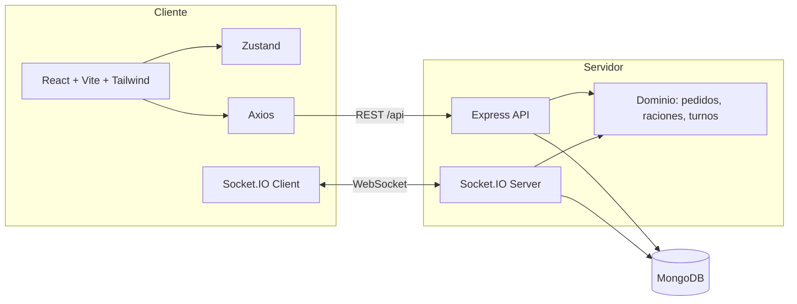

# Plan técnico — Plataforma base v2

## 1. Contexto técnico

| Área | Decisión |
|---|---|
| Runtime | Node.js 20 LTS o superior |
| Lenguaje | TypeScript 5.x |
| Base de datos | MongoDB 6+ con Mongoose 8 |
| Backend | Express 4, Socket.IO 4, CORS, JWT, bcrypt, Zod |
| Frontend | React 18+, Vite 5+, Tailwind CSS 3+, React Router 6+, Zustand 4+, Axios |
| PWA | `vite-plugin-pwa` (opcional) |
| Pruebas | Vitest, Supertest, React Testing Library, Playwright |
| Monorepo | npm workspaces (`client`, `server`, `shared`) |
| Alcance | Web responsive; sin pagos, IGV, SUNAT, APK ni tiempos de cocina |

## 2. Constitution Check

| Principio | Cumple | Evidencia |
|---|---|---|
| 1. Spec-first y trazabilidad | Sí | Cada FR referencia el PDF y una tarea. |
| 2. Un solo registro, tres vistas | Sí | Servidor autoritativo y snapshots. |
| 3. FIFO y una sola acción de cocina | Sí | Sin “En preparación”, sin tiempos, solo “Marcar listo”. |
| 4. Control de raciones y agotados | Sí | `menuItems`, `$gte`, ajustes auditados. |
| 5. Trazabilidad y cierre de turno | Sí | `takenBy`, `readyBy`, `deliveredBy`, `shifts`. |
| 6. Web responsive y alcance acotado | Sí | Sin pagos, facturación, APK ni tiempos. |

## 3. Arquitectura



- El servidor es la autoridad del estado, las raciones y los totales.
- El cliente consume REST y Socket.IO.
- No hay dependencia de pagos ni facturación.

## 4. Estructura del proyecto

```text
cevicheria-lucy/
├── client/
│   ├── src/
│   │   ├── api/
│   │   ├── components/
│   │   ├── hooks/
│   │   ├── layouts/
│   │   ├── pages/
│   │   ├── routes/
│   │   ├── stores/
│   │   ├── styles/
│   │   ├── types/
│   │   └── utils/
│   ├── public/
│   ├── index.html
│   ├── vite.config.ts
│   └── package.json
├── server/
│   ├── src/
│   │   ├── config/
│   │   ├── controllers/
│   │   ├── domain/
│   │   ├── middlewares/
│   │   ├── models/
│   │   ├── routes/
│   │   ├── services/
│   │   ├── realtime/       # spec 005
│   │   ├── utils/
│   │   ├── app.ts
│   │   └── server.ts
│   ├── tests/
│   └── package.json
├── shared/
│   ├── types/
│   └── constants/
├── .env.example
├── package.json
└── README.md
```

## 5. Modelo de datos

Fuente canónica: [`data-model.md`](data-model.md).

- `users`, `tables`, `shifts`, `tableSessions`.
- `menuSections`, `dishes`, `menuDays`, `menuItems`, `rationAdjustments`.
- `orders`, `counters`, `settings`.
- `shiftSummaries`, `manualRecords` (P2).
- Sin campos de pago, cliente tributario, IGV ni facturación.

## 6. Contratos

Fuente canónica: [`contracts/rest-api.md`](contracts/rest-api.md).

Endpoints principales:
- Auth: login, me, logout.
- Mesas: listar, cerrar sesión de mesa.
- Turnos: actual, abrir, cerrar, resumen.
- Menú: hoy, días, publicar, platos, raciones, agotado.
- Pedidos: crear, listar, detalle, listo, entregar, cancelar, cierre manual.
- Cocina: tablero pendientes/listos.
- Configuración y salud.

## 7. Dominio

### 7.1 Estados del pedido

```ts
export type OrderStatus =
  | 'ENVIADO'
  | 'LISTO'
  | 'ENTREGADO'
  | 'CANCELADO';

const TRANSITIONS = {
  ENVIADO: { LISTO: ['COCINERO'], CANCELADO: ['MOZO'] },
  LISTO: { ENTREGADO: ['MOZO'], CANCELADO: ['MOZO'] },
  ENTREGADO: {},
  CANCELADO: {}
} as const;
```

- `BORRADOR` es UI/local.
- No existe `EN_PREPARACION`.
- No se permite `ENVIADO → ENTREGADO` en el flujo normal.
- El cierre manual del encargado es una excepción P2 auditada.

### 7.2 Estados del plato

`INACTIVO`, `DISPONIBLE`, `ULTIMAS_RACIONES`, `AGOTADO`, derivados de `active`, `manuallySoldOut`, `hasRationsLimit` y `remainingRations`.

### 7.3 Descuento de raciones

- Por ítem con límite: `findOneAndUpdate` con `remainingRations: { $gte: quantity }`.
- Secuencial con compensación si un ítem falla.
- Si la creación del pedido falla, se reponen los descuentos.
- `version` no aplica a `menuItems`; la atomicidad se logra con el filtro `$gte`.

### 7.4 Cancelación

- `ENVIADO`: repone raciones y registra `CANCELLATION_REVERSAL`.
- `LISTO`: no repone; registra motivo.
- `BORRADOR`: no hubo descuento.
- `manuallySoldOut` no se limpia con una reposición.

### 7.5 Totales

`totalCents = Σ (unitPriceCents × quantity)`. Sin IGV ni impuestos.

## 8. Autenticación y seguridad

- JWT con expiración de 8 h.
- bcrypt coste ≥ 10.
- `helmet`, CORS por allowlist y rate limit en login.
- Validación Zod.
- Roles y permisos por endpoint.
- No exponer `passwordHash` ni tokens en logs.

## 9. Configuración por entorno

```dotenv
NODE_ENV=development
PORT=3000
MONGODB_URI=mongodb://127.0.0.1:27017/cevicheria_lucy
JWT_SECRET=cambiar-en-produccion
JWT_EXPIRES_IN=8h
CORS_ORIGIN=http://localhost:5173

VITE_API_URL=http://localhost:3000/api
VITE_SOCKET_URL=http://localhost:3000
```

## 10. Fases de implementación

| Fase | Contenido |
|---|---|
| 0 | Monorepo, TypeScript, lint, env. |
| 1 | Conexión MongoDB, errores, auth middleware, modelos. |
| 2 | Auth y usuarios seed. |
| 3 | Mesas, sesiones y turnos. |
| 4 | Menú, platos, menú del día, publicación. |
| 5 | Pedidos: creación, raciones, estados, totales. |
| 6 | Seed, health y quickstart. |
| 7 | Pruebas unitarias, integración y concurrencia. |
| 8 | Pulido de seguridad y documentación. |

## 11. Estrategia de pruebas

| Nivel | Herramienta | Cobertura |
|---|---|---|
| Unitaria | Vitest | Estados, totales, derivación de plato, cancelación. |
| Integración | Supertest + MongoDB de prueba | Auth, menú, pedidos, raciones, turnos. |
| Concurrencia | Script Node | Última ración y doble envío. |
| Frontend | Vitest + RTL | Stores y componentes base. |
| E2E | Playwright | Mozo → cocina → listo → entregado. |

Casos obligatorios:
- 200 envíos concurrentes sin sobreventa.
- Cancelación en Enviado repone; en Listo no.
- Transiciones inválidas rechazadas.
- Menú no publicado bloquea pedidos.
- Seed doble idempotente.

## 12. Riesgos y mitigaciones

| Riesgo | Impacto | Mitigación |
|---|---|---|
| Sin transacciones multi-documento | Inconsistencia | Compensación y pruebas. |
| Última ración concurrente | Sobreventa | `$gte` atómico. |
| Cancelación + listo simultáneos | Estado inconsistente | `version` + filtro. |
| Menú no publicado | Bloqueo | Validación y mensaje. |
| Sesión de mesa vacía | Mesa por cerrar | Cierre manual. |
| Sin CRUD de usuarios | Dependencia de seed | Seed documentado. |

## 13. Complejidad / excepciones

El descuento secuencial con compensación es una excepción consciente a la atomicidad multi-documento. Se justifica por la ausencia de replica set en la demo. En producción se evaluará una transacción o un diseño con raciones embebidas en un solo documento.

## 14. Fuera de alcance

- UIs de `002`–`006`.
- Pagos, facturación, SUNAT, IGV, costos.
- Delivery, inventario de almacén.
- App nativa/APK.
- Tiempos de cocina y alertas de demora.

## 15. Checklist del plan

- [x] Todos los FR de la spec cubiertos.
- [x] Constitution Check completo.
- [x] Modelo y contrato definidos.
- [x] Reglas de raciones y cancelación documentadas.
- [x] Pruebas planificadas.
- [x] Sin campos de pago, IGV o facturación.
