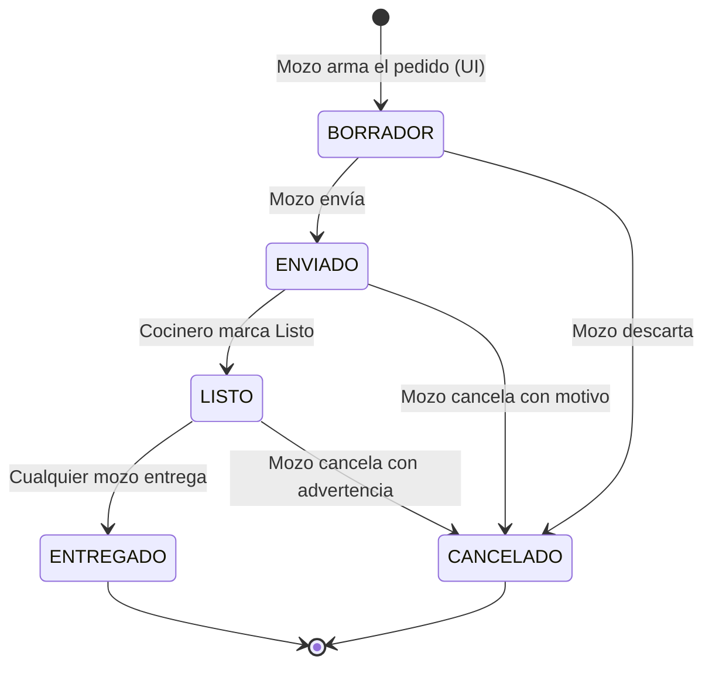

# Especificación — Plataforma base, roles y modelo canónico

## 1. Contexto y problema

La Cevichería Lucy necesita una aplicación web responsive para que el mozo registre pedidos, la cocina los reciba en orden FIFO y el encargado controle menú, raciones y cierre de turno. Antes de construir las vistas, se necesita una base común: usuarios y roles, mesas, turnos, menú, disponibilidad, pedidos y una definición única de los estados.

El PDF define seis procesos y dos máquinas de estado. Esta spec establece el modelo canónico que todos los módulos deben respetar. No implementa las pantallas del mozo (`003`), la cocina (`004`), los avisos (`005`), el cierre (`006`) ni el despliegue (`007`).

## 2. Objetivos y no objetivos

### Objetivos

- Autenticar usuarios con roles `ENCARGADO`, `MOZO` y `COCINERO`.
- Gestionar mesas y sesiones de mesa sin mozo asignado.
- Gestionar turnos configurables (por ejemplo, almuerzo y cena).
- Definir secciones, platos, variaciones, menú del día y disponibilidad.
- Definir la máquina de estados del pedido y del plato.
- Garantizar el descuento atómico de raciones al enviar un pedido.
- Exponer la API REST base y los datos de demostración.
- Registrar la trazabilidad de responsables y cambios de estado.

### No objetivos

- No implementa la UI de toma de pedidos (spec `003`).
- No implementa la UI de cocina (spec `004`).
- No implementa la UI de menú y raciones (spec `002`).
- No implementa notificaciones en tiempo real (spec `005`).
- No implementa el cierre de turno (spec `006`).
- No implementa pagos, facturación, SUNAT, IGV ni costos de variaciones.
- No implementa delivery, inventario de almacén ni app nativa/APK.

## 3. Actores y roles

| Actor | Rol | Necesidad principal |
|---|---|---|
| Mozo | `MOZO` | Iniciar sesión, registrar pedidos y entregarlos. |
| Cocinero | `COCINERO` | Iniciar sesión y ver la cola de cocina. |
| Encargado | `ENCARGADO` | Configurar menú/raciones y supervisar el turno. |
| Sistema | — | Validar reglas, descontar raciones y auditar. |
| Cliente | — | No usa la web en esta versión. |

## 4. Historias de usuario

### US-001 — Iniciar sesión según el rol (P1)

**Como** usuario del sistema, **quiero** iniciar sesión con mis credenciales, **para** acceder solo a las funciones de mi rol.

**Por qué esta prioridad:** sin autenticación no se puede registrar quién toma, prepara o entrega un pedido.

**Prueba independiente:** con un usuario por rol, iniciar sesión y verificar que la API devuelve el rol correcto y rechaza accesos no autorizados.

**Escenarios de aceptación:**

- **DADO** credenciales válidas **CUANDO** inicio sesión **ENTONCES** recibo token y perfil con rol.
- **DADO** credenciales inválidas o usuario inactivo **CUANDO** intento ingresar **ENTONCES** recibo `401` genérico.
- **DADO** un rol sin permiso **CUANDO** llama a un endpoint restringido **ENTONCES** recibe `403`.

### US-002 — Consultar mesas y su estado (P1)

**Como** mozo, **quiero** ver las mesas y si están libres, ocupadas o por cerrar, **para** elegir la mesa correcta y evitar duplicar pedidos.

**Por qué esta prioridad:** el pedido se asocia a una mesa; el PDF pide mostrar su estado.

**Prueba independiente:** abrir una mesa, enviar un pedido y verificar que la mesa pasa a ocupada; entregar todo y verificar que queda por cerrar.

**Escenarios de aceptación:**

- **DADO** una mesa sin sesión abierta **CUANDO** se consulta **ENTONCES** aparece `LIBRE`.
- **DADO** una mesa con al menos un pedido activo **CUANDO** se consulta **ENTONCES** aparece `OCUPADA`.
- **DADO** una mesa con todos los pedidos entregados o cancelados **CUANDO** se consulta **ENTONCES** aparece `POR_CERRAR`.

### US-003 — Abrir el turno (P1)

**Como** encargado, **quiero** abrir un turno, **para** habilitar la toma de pedidos del servicio.

**Por qué esta prioridad:** los pedidos y el cierre se agrupan por turno.

**Prueba independiente:** sin turno abierto, intentar enviar un pedido y verificar que se bloquea; abrir el turno y verificar que se permite.

**Escenarios de aceptación:**

- **DADO** un encargado autenticado **CUANDO** abre un turno **ENTONCES** queda como turno actual.
- **DADO** un turno abierto **CUANDO** se intenta abrir otro **ENTONCES** se rechaza o se exige cerrar el anterior.
- **DADO** un mozo sin turno abierto **CUANDO** intenta enviar un pedido **ENTONCES** se le indica que el turno no está abierto.

### US-004 — Sembrar datos de demostración (P1)

**Como** responsable de la demo, **quiero** cargar usuarios, mesas, menú y platos de ejemplo, **para** demostrar el flujo sin capturar datos manualmente.

**Por qué esta prioridad:** la demo debe ser reproducible.

**Prueba independiente:** ejecutar el seed dos veces y verificar que no duplica y que los datos quedan utilizables.

**Escenarios de aceptación:**

- **DADO** una base vacía **CUANDO** ejecuto el seed **ENTONCES** quedan usuarios, mesas, secciones, platos y configuración.
- **DADO** una base sembrada **CUANDO** ejecuto el seed otra vez **ENTONCES** no se duplican registros.
- **DADO** un seed fallido **CUANDO** lo repito **ENTONCES** converge al mismo estado.

### US-005 — Auditar responsables y cambios (P2)

**Como** encargado, **quiero** ver quién tomó, preparó, entregó o canceló un pedido, **para** encontrar la causa de un error.

**Por qué esta prioridad:** el PDF exige trazabilidad, pero la consulta detallada puede ser posterior.

**Prueba independiente:** crear un pedido, marcarlo listo, entregarlo y verificar que cada acción tiene actor y fecha.

**Escenarios de aceptación:**

- **DADO** un pedido enviado **CUANDO** se consulta **ENTONCES** muestra el mozo que lo tomó.
- **DADO** un pedido listo **CUANDO** se consulta **ENTONCES** muestra el cocinero que lo marcó.
- **DADO** un pedido entregado o cancelado **CUANDO** se consulta **ENTONCES** muestra quién lo entregó o canceló y el motivo.

## 5. Requisitos funcionales (EARS)

| ID | Requisito | Fuente | Prioridad |
|---|---|---|---|
| FR-001 | CUANDO un usuario envía credenciales válidas, EL SISTEMA DEBE autenticarlo y devolver un JWT con identidad y rol. | PDF p. 6, 15 | P1 |
| FR-002 | SI las credenciales son inválidas o el usuario está inactivo, ENTONCES EL SISTEMA DEBE responder `401` con mensaje genérico. | PDF p. 6 | P1 |
| FR-003 | CUANDO un usuario accede a un recurso, EL SISTEMA DEBE verificar que su rol tenga permiso sobre la acción. | PDF p. 6 | P1 |
| FR-004 | CUANDO se consultan las mesas, EL SISTEMA DEBE devolver código, zona y estado derivado: `LIBRE`, `OCUPADA` o `POR_CERRAR`. | PDF p. 8 | P1 |
| FR-005 | CUANDO se envía el primer pedido de una mesa en un turno, EL SISTEMA DEBE abrir una sesión de mesa con `openedBy` y `openedAt`. | PDF p. 8 | P1 |
| FR-006 | CUANDO un mozo o encargado cierra una mesa, EL SISTEMA DEBE exigir que no tenga pedidos activos y registrar `closedBy` y `closedAt`. | PDF p. 10 | P1 |
| FR-007 | CUANDO el encargado abre un turno, EL SISTEMA DEBE registrarlo como turno actual y habilitar la toma de pedidos. | PDF p. 10 | P1 |
| FR-008 | SI no hay turno abierto, ENTONCES EL SISTEMA DEBE impedir el envío de pedidos con un mensaje accionable. | PDF p. 10 | P1 |
| FR-009 | CUANDO se consulta el menú, EL SISTEMA DEBE devolver solo el menú publicado para la fecha actual, con secciones, platos, precios, variaciones y estado de disponibilidad. | PDF p. 7 | P1 |
| FR-010 | CUANDO el encargado publica un menú del día, EL SISTEMA DEBE marcarlo como `PUBLICADO` y hacerlo visible a los mozos. | PDF p. 7 | P1 |
| FR-011 | CUANDO un mozo confirma un pedido válido, EL SISTEMA DEBE crear el pedido con estado `ENVIADO`, número único, ítems embebidos, snapshots y `enviadoEn`. | PDF p. 8 | P1 |
| FR-012 | SI el pedido no tiene mesa, no tiene al menos un ítem o contiene cantidades ≤ 0, ENTONCES EL SISTEMA DEBE responder `422`. | PDF p. 8 | P1 |
| FR-013 | SI un plato está `AGOTADO`, `INACTIVO` o no tiene raciones suficientes, ENTONCES EL SISTEMA DEBE impedir el envío con `409`. | PDF pp. 10-11 | P1 |
| FR-014 | CUANDO se envía un pedido, EL SISTEMA DEBE descontar una ración por unidad en los platos con límite, de forma atómica y sin sobreventa. | PDF pp. 10-11 | P1 |
| FR-015 | CUANDO un pedido `ENVIADO` se cancela, EL SISTEMA DEBE reponer las raciones descontadas y registrar el ajuste con motivo. | PDF p. 11 | P1 |
| FR-016 | CUANDO un pedido `LISTO` se cancela, EL SISTEMA NO DEBE reponer las raciones y DEBE registrar el motivo. | PDF pp. 9-11 | P1 |
| FR-017 | CUANDO el estado del plato cambia por raciones, EL SISTEMA DEBE derivar `DISPONIBLE`, `ULTIMAS_RACIONES` o `AGOTADO` según el límite y las raciones restantes. | PDF p. 13 | P1 |
| FR-018 | CUANDO el encargado marca un plato agotado por falta de insumo, EL SISTEMA DEBE registrar `soldOutReason`, `soldOutBy` y `soldOutAt`, y bloquearlo para nuevos pedidos. | PDF pp. 8-11 | P1 |
| FR-019 | CUANDO cambia el estado de un pedido, EL SISTEMA DEBE registrar en `statusHistory` estado anterior, nuevo, fecha, actor, rol y motivo cuando aplique. | PDF p. 11 | P1 |
| FR-020 | CUANDO se crea un pedido, EL SISTEMA DEBE asignar `orderNumber` único mediante una operación atómica. | PDF p. 14 | P1 |
| FR-021 | CUANDO un pedido se marca listo, EL SISTEMA DEBE registrar `readyBy` y `readyAt`; cuando se entrega, `deliveredBy` y `deliveredAt`. | PDF pp. 9, 14 | P1 |
| FR-022 | SI un pedido intenta pasar de `ENVIADO` a `ENTREGADO`, ENTONCES EL SISTEMA DEBE rechazarlo con `409`. | PDF p. 12 | P1 |
| FR-023 | CUANDO se ejecuta el seed, EL SISTEMA DEBE cargar datos de demostración de forma idempotente. | PDF p. 15 | P1 |
| FR-024 | CUANDO se consulta la salud del sistema, EL SISTEMA DEBE reportar estado del servicio y de MongoDB. | PDF p. 15 | P1 |
| FR-025 | EL SISTEMA NO DEBE almacenar campos de pago, comprobantes, IGV, cliente tributario ni facturación. | PDF p. 15 | P1 |
| FR-026 | CUANDO se consulta un pedido, EL SISTEMA DEBE devolver el snapshot de nombres, precios y variaciones al momento de la creación. | PDF p. 8 | P1 |
| FR-027 | CUANDO se registra un ajuste de raciones, EL SISTEMA DEBE guardar actor, rol, fecha, motivo, valor anterior y valor nuevo. | PDF pp. 10-11 | P1 |
| FR-028 | CUANDO un usuario con rol `MOZO` entrega un pedido, EL SISTEMA DEBE permitirlo sin importar quién lo tomó, registrando al entregador. | PDF pp. 6, 9 | P1 |

> **Nota:** las FR-009 a FR-022 son reglas de dominio compartidas; las UIs de `002`, `003` y `004` las consumen.

## 6. Entidades y estados

El modelo canónico está en [`data-model.md`](data-model.md).

| Colección | Propósito |
|---|---|
| `users` | Roles `ENCARGADO`, `MOZO`, `COCINERO`. |
| `tables` | Mesas y zonas. |
| `tableSessions` | Apertura/cierre de mesa y agrupación de rondas. |
| `shifts` | Turnos configurables. |
| `menuSections` | Criollo, Marino, A la carta, Bebidas. |
| `dishes` | Plato, precio, tipo, variaciones. |
| `menuDays` | Menú del día y publicación. |
| `menuItems` | Disponibilidad y raciones por plato. |
| `rationAdjustments` | Reposiciones y ajustes auditados. |
| `orders` | Pedidos con ítems embebidos y trazabilidad. |
| `counters` | Numeración de pedidos. |
| `settings` | Configuración del local. |

### Estados del pedido

| Transición | Actor | Efecto |
|---|---|---|
| `BORRADOR → ENVIADO` | Mozo | Crea pedido, descuenta raciones. |
| `ENVIADO → LISTO` | Cocinero | Registra `readyBy`/`readyAt`. |
| `LISTO → ENTREGADO` | Cualquier mozo | Registra `deliveredBy`/`deliveredAt`. |
| `BORRADOR → CANCELADO` | Mozo | Descarta borrador local. |
| `ENVIADO → CANCELADO` | Mozo | Motivo; repone raciones. |
| `LISTO → CANCELADO` | Mozo | Motivo; no repone raciones; advertencia. |

No existe `EN_PREPARACION`. No se permite `ENVIADO → ENTREGADO`.

### Estados del plato

| Estado | Significado | Quién lo cambia |
|---|---|---|
| `INACTIVO` | No se ofrece en el turno. | Encargado |
| `DISPONIBLE` | Se puede preparar; si tiene límite, quedan más de 5 raciones. | Sistema |
| `ULTIMAS_RACIONES` | Quedan entre 1 y 5 raciones. | Sistema |
| `AGOTADO` | Sin raciones o sin insumo; no se puede pedir. | Sistema o Encargado |

## 7. Casos borde y errores

| ID | Caso | Comportamiento esperado |
|---|---|---|
| EC-001 | No hay turno abierto. | `409`; el mozo ve “Turno no abierto”. |
| EC-002 | La mesa tiene una sesión abierta. | Se permite agregar una nueva ronda a la misma sesión. |
| EC-003 | La mesa está por cerrar y se agrega un pedido. | Se reabre la sesión o se crea una nueva, según regla documentada. |
| EC-004 | El plato se agota entre la selección y el envío. | `409`; refrescar menú. |
| EC-005 | Dos mozos envían el último plato a la vez. | Solo uno descuenta la última ración; el otro recibe `409`. |
| EC-006 | Doble tap en “Enviar”. | Un solo pedido por `clientRequestId`. |
| EC-007 | Cancelación y “Listo” ocurren a la vez. | Una transición gana; la otra recibe `409`. |
| EC-008 | Se intenta cerrar una mesa con pedidos activos. | `409`; primero entregar o cancelar. |
| EC-009 | Se intenta publicar un menú sin platos. | `422`. |
| EC-010 | Se ajusta una ración a un valor negativo. | `422`. |
| EC-011 | Se marca agotado un plato con raciones restantes. | Se permite; el estado queda `AGOTADO` por insumo. |
| EC-012 | El token expira. | `401`; el cliente vuelve al login. |
| EC-013 | El menú no está publicado. | El mozo no puede pedir; mensaje de menú no disponible. |
| EC-014 | Se intenta modificar un pedido enviado. | `409`; debe cancelar y crear otro. |

## 8. Requisitos no funcionales

| ID | Requisito | Métrica / criterio |
|---|---|---|
| NFR-001 | Las consultas simples deben ser rápidas. | p95 ≤ 300 ms en local. |
| NFR-002 | El envío de pedido debe ser rápido. | p95 ≤ 800 ms con 20 pedidos concurrentes. |
| NFR-003 | El descuento de raciones debe ser atómico. | 0 sobreventa en 200 envíos concurrentes. |
| NFR-004 | Las contraseñas nunca se almacenan en claro. | bcrypt coste ≥ 10. |
| NFR-005 | Los secretos no se exponen. | JWT y Mongo por variables de entorno. |
| NFR-006 | El acceso debe estar restringido por rol. | 100% de accesos indebidos rechazados. |
| NFR-007 | Las entradas se validan antes de persistir. | `400/422` con detalle. |
| NFR-008 | Las consultas críticas deben estar indexadas. | Índices de `data-model.md`. |
| NFR-009 | Los errores deben ser diagnosticables. | `requestId` y logs sin datos sensibles. |
| NFR-010 | No se muestran tiempos de cocina. | Sin cronómetros ni alertas de demora en la API/UI. |
| NFR-011 | La configuración es portable. | Sin URLs ni secretos hardcodeados. |

## 9. Criterios de éxito medibles

| ID | Criterio | Cómo se mide |
|---|---|---|
| SC-001 | Los tres roles inician sesión y acceden solo a sus funciones. | Prueba E2E; 100% de accesos indebidos rechazados. |
| SC-002 | No hay sobreventa de raciones. | 200 envíos concurrentes; 0 sobreventa. |
| SC-003 | No se generan números de pedido duplicados. | 1 000 creaciones; 0 duplicados. |
| SC-004 | Las cancelaciones aplican la regla de raciones. | 100% Enviado repone; 100% Listo no repone. |
| SC-005 | Todos los ajustes de raciones quedan auditados. | 100% con actor, motivo y valores. |
| SC-006 | El seed deja la demo lista en ≤ 60 s. | Cronometraje. |
| SC-007 | Ningún pedido puede saltar de Enviado a Entregado. | Suite de transiciones; 100% rechazadas. |
| SC-008 | No existen campos de pago, IGV o facturación. | Revisión de modelo y API; 0 campos. |

## 10. Supuestos

- Un solo local, una cocina y una instancia de servidor.
- El turno lo abre el encargado; sin turno abierto no se envían pedidos.
- El `BORRADOR` vive en la UI; no se persiste como pedido.
- Las raciones se descuentan al enviar, no al agregar al borrador.
- El menú se publica por día; si se requiere por turno, se ajusta.
- No se registran comensales por mesa en esta versión.
- No hay CRUD de usuarios en la demo; se usan usuarios sembrados.
- No hay pagos, facturación, IGV ni costos de variaciones.

## 11. Dependencias y riesgos

| Tipo | Descripción | Mitigación |
|---|---|---|
| Dependencia | `002`, `003`, `004`, `005` y `006` consumen este modelo. | Congelar `data-model.md` y `rest-api.md`. |
| Dependencia | `007` define el despliegue. | Configuración por entorno desde el inicio. |
| Riesgo | Concurrencia en la última ración. | `findOneAndUpdate` atómico y filtro por raciones. |
| Riesgo | Cancelación y “Listo” simultáneos. | `version` y filtro por estado. |
| Riesgo | Menú no publicado. | Validación en envío y UI. |
| Riesgo | Crecimiento del menú. | Índices y paginación si aplica. |

## 12. Fuera de alcance

- UI del mozo, cocina, menú y cierre.
- Notificaciones en tiempo real.
- Pagos, facturación, SUNAT, IGV.
- Delivery, inventario de almacén, costos.
- App nativa/APK.
- Tiempos de cocina y alertas de demora.
- Multi-local y multi-tenant.

## 13. Preguntas abiertas

| ID | Pregunta | Impacto | Estado |
|---|---|---|---|
| Q-001-01 | ¿El turno se abre manualmente o se crea al primer pedido? | Medio | `[NECESITA ACLARACIÓN]` (se propone manual). |
| Q-001-02 | ¿Se registrarán comensales por mesa? | Bajo | `[NECESITA ACLARACIÓN]` (se propone no). |
| Q-001-03 | ¿Las raciones son por día o por turno? | Alto | `[NECESITA ACLARACIÓN]` (se propone por día). |
| Q-001-04 | ¿Se permite reabrir una mesa por cerrar al agregar otro pedido? | Medio | `[NECESITA ACLARACIÓN]` (se propone nueva ronda). |
| Q-001-05 | ¿Se requiere CRUD de usuarios y mesas? | Medio | `[NECESITA ACLARACIÓN]` (se propone seed). |
| Q-001-06 | ¿Se muestra el número de pedido en las vistas? | Bajo | `[NECESITA ACLARACIÓN]`. |
| Q-001-07 | ¿Qué retención tendrá el historial de pedidos? | Bajo | `[NECESITA ACLARACIÓN]`. |

## 14. Trazabilidad

| Fuente | Sección | Historias | Requisitos | Criterios |
|---|---|---|---|---|
| PDF p. 6 | Actores y responsabilidades | US-001, US-005 | FR-001–FR-003, FR-021, FR-028 | SC-001, SC-005 |
| PDF p. 8 | P-02 Tomar y enviar | US-002 | FR-004–FR-006, FR-011–FR-013 | SC-002, SC-003 |
| PDF pp. 10-11 | P-05 y RN-03/RN-04 | US-002 | FR-014–FR-018, FR-027 | SC-002, SC-004, SC-005 |
| PDF p. 10 | P-06 Cierre de turno | US-003 | FR-007, FR-008 | SC-001 |
| PDF p. 12 | Estados del pedido | — | FR-019–FR-022 | SC-007 |
| PDF p. 13 | Estados del plato | — | FR-017, FR-018 | SC-002, SC-004 |
| PDF p. 14 | Flujo general | — | FR-011, FR-014, FR-020, FR-021 | SC-003 |
| PDF p. 15 | Decisiones y alcance | US-004 | FR-023–FR-025 | SC-006, SC-008 |
