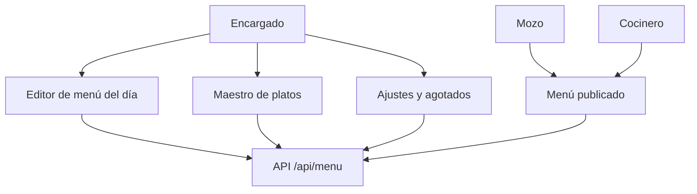

# Plan técnico — Menú, raciones y agotados

## 1. Contexto técnico

| Área | Decisión |
|---|---|
| UI | React + Vite + Tailwind |
| Estado | Zustand (`menuAdminStore`, `menuPublicStore`) |
| HTTP | Axios con JWT |
| Formularios | Componentes controlados + validación Zod |
| Tiempo real | Eventos de disponibilidad de `005` |
| Pruebas | Vitest + React Testing Library + Supertest |

## 2. Constitution Check

| Principio | Cumple | Evidencia |
|---|---|---|
| 1. Spec-first y trazabilidad | Sí | Cada FR mapea a una tarea. |
| 2. Un solo registro, tres vistas | Sí | Menú publicado único para todos. |
| 3. FIFO y una sola acción de cocina | Sí | No se agregan acciones de cocina. |
| 4. Control de raciones y agotados | Sí | Descuento atómico, ajustes auditados. |
| 5. Trazabilidad y cierre de turno | Sí | Ajustes con actor/motivo. |
| 6. Web responsive y alcance acotado | Sí | Sin costos, IGV, pagos ni tiempos. |

## 3. Arquitectura de UI



## 4. Estructura

```text
client/src/
├── pages/
│   ├── encargado/
│   │   ├── MenuDayPage.tsx
│   │   ├── DishesPage.tsx
│   │   └── RationAdjustmentsPage.tsx
│   └── shared/
│       └── MenuView.tsx
├── components/
│   └── menu/
│       ├── MenuSectionTabs.tsx
│       ├── DishCard.tsx
│       ├── AvailabilityBadge.tsx
│       ├── RationBadge.tsx
│       ├── RationInput.tsx
│       ├── VariationEditor.tsx
│       ├── PublishMenuButton.tsx
│       ├── SoldOutModal.tsx
│       ├── ReplenishRationsModal.tsx
│       ├── AdjustRationsModal.tsx
│       └── AdjustmentHistory.tsx
├── stores/
│   ├── menuAdminStore.ts
│   └── menuPublicStore.ts
├── api/
│   └── menu.api.ts
└── utils/
    └── dishState.ts
```

## 5. Flujo del encargado

### 5.1 Menú del día

1. Seleccionar fecha.
2. Crear menú `BORRADOR` o abrir existente.
3. Elegir sección y agregar platos del maestro.
4. Configurar `active`, `hasRationsLimit`, `totalRations`, `remainingRations`.
5. Revisar precios y variaciones.
6. Publicar.
7. Si ya está publicado, solo se permiten ajustes de disponibilidad/raciones (Q-002-03).

### 5.2 Maestro de platos

- Crear/editar plato: sección, nombre, descripción, precio, `course`, `isFixed`, `isRotating`, variaciones.
- Desactivar plato sin borrar historial.
- Las variaciones no tienen precio.

### 5.3 Raciones y agotados

- Reponer raciones (mozo/encargado) con motivo.
- Ajustar conteo (encargado) con motivo.
- Marcar agotado por insumo (encargado).
- Reactivar (encargado).
- Ver historial de ajustes.

## 6. Flujo del mozo

- Consumir `/api/menu/today`.
- Mostrar tabs por sección.
- Cada plato muestra:
  - Nombre, descripción, precio.
  - Badge `DISPONIBLE`, `ULTIMAS_RACIONES`, `AGOTADO`.
  - Raciones restantes si tiene límite.
  - Botón “Agregar” deshabilitado si `AGOTADO`/`INACTIVO`.
- Si el plato se agota mientras el mozo está en la vista, el evento de `005` actualiza el badge y muestra un toast.
- La lógica de selección y carrito pertenece a `003`; este feature provee los componentes y datos.

## 7. Estado

### `menuAdminStore`

- `selectedDate`, `menuDay`, `dishes`, `sections`, `loading`, `error`.
- Acciones: `loadDay`, `createDay`, `updateDay`, `publish`, `createDish`, `updateDish`, `deactivateDish`, `replenish`, `adjust`, `soldOut`, `reactivate`.

### `menuPublicStore`

- `menuDay`, `loading`, `error`, `lastUpdatedAt`.
- Acciones: `loadToday`, `applyAvailabilityEvent`.

## 8. Validaciones

- `priceCents` entero ≥ 0.
- `totalRations` entero ≥ 0.
- `remainingRations` entero ≥ 0 y ≤ `totalRations` en la configuración inicial.
- `lowStockThreshold` entero ≥ 0.
- Variaciones: nombre no vacío, sin duplicados.
- Publicar: al menos un ítem activo.
- No se aceptan campos de costo, IGV ni pago.

## 9. Manejo de errores

| Situación | UI |
|---|---|
| `409` agotado/raciones | Toast y refresco del menú. |
| `422` validación | Mensajes por campo. |
| `403` rol | Ocultar acciones no permitidas. |
| `503` | Banner de reintento. |
| Evento de disponibilidad | Actualización sin recargar. |

## 10. Testing

| Nivel | Casos |
|---|---|
| Unitaria | `dishState`, validaciones, totales. |
| Componentes | Editor de menú, badges, modales. |
| Integración | Publicar, reponer, ajustar, agotar. |
| Concurrencia | Última ración con dos pedidos. |
| E2E | Encargado publica → mozo ve → agota → bloqueo. |

## 11. Riesgos

| Riesgo | Mitigación |
|---|---|
| Sobreventa | `$gte` atómico y refresco. |
| Menú desactualizado | Eventos de `005` + resync. |
| Ajustes sin motivo | Validación y auditoría. |
| Variaciones ambiguas | Lista plana; Q-002-06. |
| Raciones por turno | Q-002-01. |
| Edición de publicado | Despublicar/versionar. |

## 12. Fuera de alcance

- Inventario de almacén.
- Costos, IGV, pagos, facturación.
- Tiempos de cocina.
- APK.
- Carrito y envío (spec `003`).

## 13. Checklist del plan

- [x] FR cubiertos.
- [x] Constitution Check.
- [x] Contratos referenciados.
- [x] Validaciones y auditoría.
- [x] Pruebas planificadas.
- [x] Sin costos/IGV.
