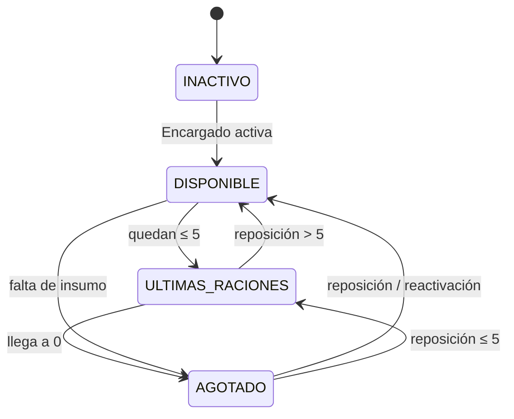

# Especificación — Menú, raciones y agotados

## 1. Contexto y problema

El encargado necesita cargar el menú del día, definir qué platos tienen límite, cuántas raciones hay y qué variaciones se permiten. El mozo necesita ver disponibilidad y raciones restantes para no ofrecer platos agotados. El sistema debe descontar raciones automáticamente y bloquear la venta cuando no queden unidades o falte un insumo.

Esta spec cubre **P-01** y **P-05**. No implementa la toma de pedidos (`003`), la cocina (`004`) ni el cierre de turno (`006`), pero define las reglas que esos módulos consumen.

## 2. Objetivos y no objetivos

### Objetivos

- Permitir que el encargado configure secciones, platos, precios, variaciones y disponibilidad.
- Permitir que el encargado defina raciones por plato y publique el menú del día.
- Mostrar al mozo disponibilidad, raciones restantes y estados `ULTIMAS_RACIONES`/`AGOTADO`.
- Descontar raciones al confirmar un pedido.
- Permitir que el mozo reponga raciones tras confirmar con cocina.
- Permitir que el encargado marque agotado por insumo y ajuste el conteo con motivo.
- Auditar todos los ajustes.

### No objetivos

- No implementa la UI de toma de pedidos.
- No implementa la cola de cocina.
- No implementa pagos, IGV, facturación ni costos de variaciones.
- No implementa inventario de insumos de almacén.
- No implementa tiempos de cocina.
- No implementa app nativa/APK.

## 3. Actores y roles

| Actor | Rol | Necesidad principal |
|---|---|---|
| Encargado | `ENCARGADO` | Configurar menú, precios, variaciones, raciones y agotados. |
| Mozo | `MOZO` | Ver disponibilidad, pedir y reponer raciones tras confirmar con cocina. |
| Cocinero | `COCINERO` | Ver el menú/disponibilidad; no modifica stock. |
| Sistema | — | Descontar raciones y derivar estados. |

## 4. Historias de usuario

### US-001 — Configurar el menú del día (P1)

**Como** encargado, **quiero** cargar o actualizar el menú del día con secciones, platos, precios y disponibilidad, **para** que los mozos vendan solo lo que se puede preparar.

**Por qué esta prioridad:** es el punto de partida de P-01 y de toda la operación.

**Prueba independiente:** crear un menú del día con secciones Criollo/Marino/A la carta, agregar platos y publicarlo; verificar que el mozo lo ve.

**Escenarios de aceptación:**

- **DADO** un encargado autenticado **CUANDO** crea el menú del día **ENTONCES** queda en `BORRADOR`.
- **DADO** un menú en borrador **CUANDO** agrega platos y precios **ENTONCES** puede activarlos o desactivarlos.
- **DADO** un menú con ítems activos **CUANDO** lo publica **ENTONCES** el mozo lo ve en `/api/menu/today`.
- **DADO** un menú sin ítems activos **CUANDO** intenta publicarlo **ENTONCES** recibe `422`.

### US-002 — Definir raciones y variaciones (P1)

**Como** encargado, **quiero** definir qué platos tienen límite, cuántas raciones y qué variaciones se permiten, **para** controlar la venta y evitar errores en cocina.

**Por qué esta prioridad:** P-01 y RN-02/RN-08.

**Prueba independiente:** configurar un plato con 30 raciones y tres variaciones; verificar que el mozo ve el límite y puede seleccionar las variaciones.

**Escenarios de aceptación:**

- **DADO** un plato sin límite **CUANDO** se configura **ENTONCES** queda `DISPONIBLE` sin “Últimas raciones”.
- **DADO** un plato con límite de 30 **CUANDO** se configura **ENTONCES** quedan 30 raciones y se muestra el límite.
- **DADO** un plato con variaciones **CUANDO** el mozo lo agrega **ENTONCES** solo puede elegir las variaciones definidas.
- **DADO** una variación sin costo **CUANDO** se agrega al pedido **ENTONCES** no altera el total.

### US-003 — Ver disponibilidad y raciones restantes (P1)

**Como** mozo, **quiero** ver si un plato está disponible, en últimas raciones o agotado, **para** ofrecer alternativas sin preguntar a cocina.

**Por qué esta prioridad:** P-02 y P-05.

**Prueba independiente:** con un plato de 6 raciones, vender una y verificar que pasa a “Últimas raciones”; vender las 5 restantes y verificar “Agotado”.

**Escenarios de aceptación:**

- **DADO** un plato con más de 5 raciones **CUANDO** se consulta **ENTONCES** aparece `DISPONIBLE`.
- **DADO** un plato con 5 o menos raciones **CUANDO** se consulta **ENTONCES** aparece `ULTIMAS_RACIONES`.
- **DADO** un plato con 0 raciones **CUANDO** se consulta **ENTONCES** aparece `AGOTADO`.
- **DADO** un plato marcado agotado por insumo **CUANDO** se consulta **ENTONCES** aparece `AGOTADO` aunque tenga raciones.

### US-004 — Descontar raciones al confirmar (P1)

**Como** sistema, **quiero** descontar una ración por unidad confirmada, **para** que never venderse de más.

**Por qué esta prioridad:** RN-03 y P-05.

**Prueba independiente:** enviar un pedido de 2 unidades de un plato con límite y verificar que las raciones bajan en 2; cancelar en `ENVIADO` y verificar que vuelven.

**Escenarios de aceptación:**

- **DADO** un plato con 10 raciones **CUANDO** se envía un pedido de 2 **ENTONCES** quedan 8.
- **DADO** un plato con 1 ración **CUANDO** dos mozos envían un pedido a la vez **ENTONCES** solo uno gana y el otro recibe `409`.
- **DADO** un pedido `ENVIADO` cancelado **CUANDO** se procesa **ENTONCES** las raciones vuelven.
- **DADO** un pedido `LISTO` cancelado **CUANDO** se procesa **ENTONCES** las raciones no vuelven.

### US-005 — Reponer raciones (P2)

**Como** mozo, **quiero** reponer raciones después de confirmar con cocina que sobraron porciones, **para** volver a ofrecer el plato.

**Por qué esta prioridad:** P-05; es una operación de excepción.

**Prueba independiente:** reponer 10 raciones de un plato agotado y verificar que vuelve a `DISPONIBLE` y que el ajuste queda auditado.

**Escenarios de aceptación:**

- **DADO** un plato agotado **CUANDO** el mozo repone 10 raciones **ENTONCES** vuelve a `DISPONIBLE`.
- **DADO** un plato con 0 raciones **CUANDO** repone 3 **ENTONCES** queda `ULTIMAS_RACIONES`.
- **DADO** una reposición sin motivo **CUANDO** se intenta **ENTONCES** se rechaza.
- **DADO** un plato marcado agotado por insumo **CUANDO** se reponen raciones **ENTONCES** sigue `AGOTADO` hasta que el encargado lo reactive.

### US-006 — Marcar agotado y ajustar conteo (P2)

**Como** encargado, **quiero** marcar un plato agotado por falta de insumo o corregir el conteo con un motivo, **para** reflejar la realidad de cocina.

**Por qué esta prioridad:** P-05; excepción operativa.

**Prueba independiente:** marcar un plato agotado con 8 raciones restantes y verificar que se bloquea; ajustar el conteo a 12 y verificar que el cambio queda auditado.

**Escenarios de aceptación:**

- **DADO** un plato con raciones **CUANDO** el encargado lo marca agotado por insumo **ENTONCES** se bloquea y se registra el motivo.
- **DADO** un plato agotado por insumo **CUANDO** el encargado lo reactiva **ENTONCES** el estado se recalcula por raciones.
- **DADO** una diferencia de conteo **CUANDO** el encargado ajusta a 12 **ENTONCES** se registra antes/después y motivo.
- **DADO** un ajuste negativo **CUANDO** se intenta **ENTONCES** se rechaza.

## 5. Requisitos funcionales (EARS)

| ID | Requisito | Fuente | Prioridad |
|---|---|---|---|
| FR-001 | CUANDO el encargado crea un menú del día, EL SISTEMA DEBE crearlo en estado `BORRADOR` para la fecha indicada. | P-01 | P1 |
| FR-002 | CUANDO el encargado agrega o actualiza platos del menú, EL SISTEMA DEBE validar sección, precio, tipo y variaciones. | P-01 | P1 |
| FR-003 | CUANDO el encargado activa o desactiva un plato del menú, EL SISTEMA DEBE reflejarlo en la disponibilidad del día. | P-01 | P1 |
| FR-004 | CUANDO el encargado publica el menú, EL SISTEMA DEBE exigir al menos un ítem activo y hacerlo visible a los mozos. | P-01 | P1 |
| FR-005 | CUANDO el encargado define un plato con límite, EL SISTEMA DEBE exigir total de raciones y raciones restantes ≥ 0. | P-01, P-05 | P1 |
| FR-006 | CUANDO el encargado define variaciones, EL SISTEMA DEBE guardarlas sin costo y asociarlas al plato. | P-01, RN-08 | P1 |
| FR-007 | CUANDO se consulta el menú publicado, EL SISTEMA DEBE devolver secciones, platos, precios, variaciones y estado derivado. | P-02, P-05 | P1 |
| FR-008 | CUANDO un plato tiene 5 o menos raciones, EL SISTEMA DEBE mostrarlo como `ULTIMAS_RACIONES`. | RN-04 | P1 |
| FR-009 | CUANDO un plato llega a 0 raciones, EL SISTEMA DEBE mostrarlo como `AGOTADO` y bloquearlo. | RN-04, RN-05 | P1 |
| FR-010 | CUANDO un plato está `AGOTADO` o `INACTIVO`, EL SISTEMA DEBE impedir agregarlo a un pedido. | RN-05 | P1 |
| FR-011 | CUANDO se envía un pedido, EL SISTEMA DEBE descontar una ración por unidad de cada plato con límite. | RN-03 | P1 |
| FR-012 | SI no hay raciones suficientes, ENTONCES EL SISTEMA DEBE rechazar el pedido con `409` y no modificar otras raciones. | P-05 | P1 |
| FR-013 | CUANDO se cancela un pedido `ENVIADO`, EL SISTEMA DEBE reponer las raciones y registrar `CANCELLATION_REVERSAL`. | P-05, RN-07 | P1 |
| FR-014 | CUANDO se cancela un pedido `LISTO`, EL SISTEMA DEBE no reponer raciones y registrar el motivo. | P-05, RN-07 | P1 |
| FR-015 | CUANDO el mozo repone raciones, EL SISTEMA DEBE exigir motivo, incrementar `remainingRations` y auditar. | P-05, RN-11 | P2 |
| FR-016 | CUANDO el encargado ajusta el conteo, EL SISTEMA DEBE fijar `remainingRations`, exigir motivo y auditar antes/después. | P-05 | P2 |
| FR-017 | CUANDO el encargado marca agotado por insumo, EL SISTEMA DEBE registrar motivo, actor y fecha, y bloquear el plato. | P-05 | P1 |
| FR-018 | CUANDO el encargado reactiva un plato agotado por insumo, EL SISTEMA DEBE recalcular su estado por raciones. | P-05 | P2 |
| FR-019 | CUANDO se modifica un plato o precio, EL SISTEMA DEBE conservar los snapshots de pedidos anteriores. | P-01 | P1 |
| FR-020 | EL SISTEMA NO DEBE incluir costos en las variaciones ni impuestos en los precios. | P-01, p. 15 | P1 |
| FR-021 | CUANDO se consulta el historial de ajustes, EL SISTEMA DEBE devolver actor, rol, motivo, antes y después. | P-05 | P2 |
| FR-022 | CUANDO un plato no tiene límite, EL SISTEMA NO DEBE mostrar `ULTIMAS_RACIONES`. | P-05 | P1 |
| FR-023 | CUANDO cambia la disponibilidad o las raciones, EL SISTEMA DEBE emitir el evento de disponibilidad (spec `005`). | P-05 | P1 |

## 6. Entidades y estados

Entidades canónicas: [`001/data-model.md`](../001-plataforma-base/data-model.md) §3.5–3.9.

- `menuSections`, `dishes`, `menuDays`, `menuItems`, `rationAdjustments`.
- Estados del plato: `INACTIVO`, `DISPONIBLE`, `ULTIMAS_RACIONES`, `AGOTADO`.
- El estado se deriva; no se edita manualmente salvo `manuallySoldOut`.

## 7. Casos borde y errores

| ID | Caso | Comportamiento esperado |
|---|---|---|
| EC-001 | No hay menú publicado. | El mozo no puede pedir; `MENU_NOT_PUBLISHED`. |
| EC-002 | El menú no tiene ítems activos. | `422` al publicar. |
| EC-003 | Se define un plato con 0 raciones. | `AGOTADO`; no se puede pedir. |
| EC-004 | Se repone por encima del total preparado. | Se permite con motivo; se audita (Q-002-02). |
| EC-005 | Se ajusta a un valor negativo. | `422`. |
| EC-006 | Dos mozos piden la última ración. | Uno gana; el otro `409`. |
| EC-007 | El plato se agota entre la selección y el envío. | `409`; refrescar menú. |
| EC-008 | El plato está agotado por insumo con raciones > 0. | Sigue `AGOTADO`; no se vende. |
| EC-009 | Se cancela un pedido `LISTO`. | No se repone; se registra motivo. |
| EC-010 | Se cancela un pedido `ENVIADO`. | Se repone; se audita. |
| EC-011 | Se edita un menú ya publicado. | Se rechaza la edición; solo se permiten ajustes de disponibilidad/raciones (Q-002-03). |
| EC-012 | Se cambia el precio de un plato con pedidos. | Los pedidos previos conservan snapshot. |
| EC-013 | Se intenta publicar dos menús para la misma fecha. | `409`. |
| EC-014 | Se repone un plato inactivo. | Se rechaza; primero se activa. |
| EC-015 | El umbral de últimas raciones no es 5. | Se usa `settings.lowStockThreshold` (default 5). |

## 8. Requisitos no funcionales

| ID | Requisito | Métrica / criterio |
|---|---|---|
| NFR-001 | El menú debe cargar rápido. | p95 ≤ 500 ms con 50 platos. |
| NFR-002 | El descuento de raciones debe ser atómico. | 0 sobreventa en 200 pedidos concurrentes. |
| NFR-003 | Los ajustes deben ser auditables. | 100% con actor, motivo y antes/después. |
| NFR-004 | La UI debe ser usable en móvil/tablet. | Desde 360 px; objetivos ≥ 44 px. |
| NFR-005 | El estado del plato debe ser consistente. | 100% de consultas coinciden con las raciones. |
| NFR-006 | No debe haber costos ni impuestos. | 0 campos de costo/IGV. |
| NFR-007 | La publicación debe ser atómica. | Un menú publicado por fecha. |
| NFR-008 | Los cambios de disponibilidad deben notificarse. | Evento en ≤ 2 s en demo. |

## 9. Criterios de éxito medibles

| ID | Criterio | Cómo se mide |
|---|---|---|
| SC-001 | El 100% del menú publicado es visible para el mozo. | Prueba de publicación. |
| SC-002 | 0 sobreventa en 200 pedidos concurrentes. | Prueba de concurrencia. |
| SC-003 | El 100% de platos agotados bloquea nuevos pedidos. | Suite de disponibilidad. |
| SC-004 | El 100% de ajustes queda auditado. | Revisión de `rationAdjustments`. |
| SC-005 | Cancelar en Enviado repone; en Listo no. | 100% de casos. |
| SC-006 | Las variaciones no alteran el total. | Prueba de totales. |
| SC-007 | No existen campos de IGV, costo o pago. | Revisión de modelo/API. |

## 10. Supuestos

- El menú se gestiona por día; las raciones son del día (Q-002-01).
- El umbral de “Últimas raciones” es 5, configurable en `settings`.
- El mozo puede reponer; el encargado puede reponer y ajustar.
- El encargado puede marcar agotado por insumo con raciones restantes.
- Las variaciones no tienen costo.
- El menú publicado no se edita libremente; se despublica o se crea otra versión (Q-002-03).
- No se manejan comensales por mesa.
- No se manejan costos ni impuestos.

## 11. Dependencias y riesgos

| Tipo | Descripción | Mitigación |
|---|---|---|
| Dependencia | `001` provee modelo, estados y API base. | Congelar `data-model.md`. |
| Dependencia | `003` descuenta raciones al enviar. | Contrato y pruebas compartidas. |
| Dependencia | `005` emite cambios de disponibilidad. | Evento canónico. |
| Riesgo | Sobreventa por concurrencia. | `findOneAndUpdate` con `$gte`. |
| Riesgo | Reposición por encima del total. | Auditar y permitir con motivo. |
| Riesgo | Menú publicado editado. | Versionado/despublicación. |
| Riesgo | Raciones por día vs turno. | Q-002-01. |
| Riesgo | Confusión con inventario de almacén. | Fuera de alcance. |

## 12. Fuera de alcance

- Inventario de insumos de almacén.
- Costos, IGV, pagos, facturación.
- Delivery.
- Tiempos de cocina.
- App nativa/APK.
- CRUD de usuarios.

## 13. Preguntas abiertas

| ID | Pregunta | Impacto | Estado |
|---|---|---|---|
| Q-002-01 | ¿Las raciones son por día o por turno? | Alto | `[NECESITA ACLARACIÓN]` (se propone por día). |
| Q-002-02 | ¿Se permite reponer por encima del total preparado? | Medio | `[NECESITA ACLARACIÓN]` (se propone sí, con motivo). |
| Q-002-03 | ¿Se puede editar un menú publicado o se debe despublicar? | Medio | `[NECESITA ACLARACIÓN]` (se propone despublicar/versionar). |
| Q-002-04 | ¿El umbral de 5 es fijo o configurable? | Bajo | `[NECESITA ACLARACIÓN]` (se propone configurable). |
| Q-002-05 | ¿Se requiere un plato “del día” con rotación automática? | Bajo | `[NECESITA ACLARACIÓN]` (se propone selección manual). |
| Q-002-06 | ¿Se permite más de una variación del mismo grupo? | Bajo | `[NECESITA ACLARACIÓN]` (se propone sí, sin costo). |

## 14. Trazabilidad

| Fuente | Sección | Historias | Requisitos | Criterios |
|---|---|---|---|---|
| PDF p. 7 | P-01 Configurar menú, raciones y variaciones | US-001, US-002 | FR-001–FR-006, FR-019, FR-020 | SC-001, SC-006, SC-007 |
| PDF p. 10 | P-05 Controlar raciones y agotados | US-003, US-004, US-005, US-006 | FR-007–FR-018, FR-021–FR-023 | SC-002–SC-005 |
| PDF p. 11 | RN-01 a RN-05, RN-08, RN-11 | US-002, US-004, US-005 | FR-005, FR-006, FR-011–FR-018 | SC-002–SC-005 |
| PDF p. 13 | Estados del plato | US-003 | FR-008, FR-009, FR-022 | SC-003 |
| PDF p. 15 | Decisiones y alcance | US-002, US-006 | FR-020 | SC-007 |
