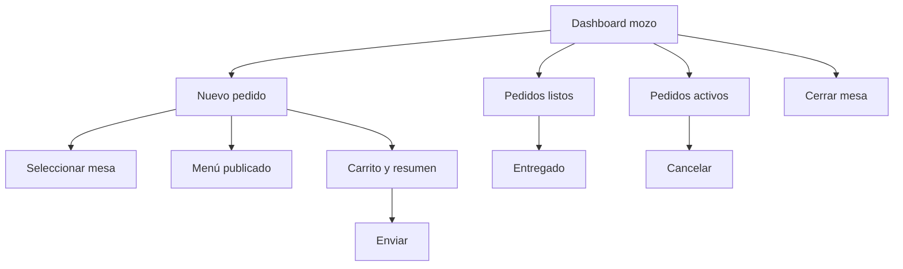

# Plan técnico — Toma de pedidos (Mozo)

## 1. Contexto técnico

| Área | Decisión |
|---|---|
| UI | React + Vite + Tailwind, mobile-first |
| Estado | Zustand (`orderDraftStore`, `ordersStore`, `tablesStore`) |
| HTTP | Axios con JWT |
| Tiempo real | Socket.IO Client (spec `005`) |
| Persistencia local | `localStorage` para borrador (P2) |
| Pruebas | Vitest + React Testing Library + Playwright |

## 2. Constitution Check

| Principio | Cumple | Evidencia |
|---|---|---|
| 1. Spec-first y trazabilidad | Sí | Cada FR tiene tarea. |
| 2. Un solo registro, tres vistas | Sí | Todos ven el mismo pedido. |
| 3. FIFO y una sola acción de cocina | Sí | El mozo no tiene acciones de cocina. |
| 4. Control de raciones y agotados | Sí | Bloqueo y `409`. |
| 5. Trazabilidad y cierre de turno | Sí | `takenBy`, `deliveredBy`, cierre de mesa. |
| 6. Web responsive y alcance acotado | Sí | Sin pagos, IGV, tiempos ni APK. |

## 3. Arquitectura de UI



### Rutas

| Ruta | Componente | Acceso |
|---|---|---|
| `/mozo` | `WaiterDashboardPage` | `MOZO` |
| `/mozo/pedido/nuevo` | `NewOrderPage` | `MOZO` |
| `/mozo/pedidos` | `ActiveOrdersPage` | `MOZO` |
| `/mozo/pedidos/:id` | `OrderDetailPage` | `MOZO` |

## 4. Estructura

```text
client/src/
├── pages/mozo/
│   ├── WaiterDashboardPage.tsx
│   ├── NewOrderPage.tsx
│   ├── ActiveOrdersPage.tsx
│   └── OrderDetailPage.tsx
├── components/mozo/
│   ├── TableSelector.tsx
│   ├── OrderCart.tsx
│   ├── QuantityStepper.tsx
│   ├── VariationSheet.tsx
│   ├── ItemNotesModal.tsx
│   ├── OrderSummary.tsx
│   ├── OrderStatusBadge.tsx
│   ├── ReadyOrderCard.tsx
│   ├── CancelOrderModal.tsx
│   └── CloseTableButton.tsx
├── stores/
│   ├── orderDraftStore.ts
│   ├── ordersStore.ts
│   └── tablesStore.ts
├── api/
│   ├── orders.api.ts
│   ├── tables.api.ts
│   └── menu.api.ts
└── hooks/
    └── useOrderEvents.ts
```

## 5. Flujo de pedido

1. Verificar turno abierto y menú publicado.
2. Seleccionar mesa (estado `LIBRE`, `OCUPADA` o `POR_CERRAR`).
3. Agregar platos `DISPONIBLE`/`ULTIMAS_RACIONES`.
4. Elegir variaciones permitidas y nota.
5. Ajustar cantidades, limitadas por raciones restantes.
6. Revisar resumen y total (`Σ precio × cantidad`, sin IGV).
7. Enviar con `clientRequestId`.
8. Confirmar con número de pedido y estado `ENVIADO`.
9. Limpiar borrador.

### Idempotencia

- `clientRequestId` UUID generado al iniciar el borrador.
- Se reutiliza en reintentos.
- Si el servidor devuelve `200` idempotente, tratar como éxito.
- Botón deshabilitado mientras `isSubmitting`.

## 6. Estado

### `orderDraftStore`

- `tableId`, `items[]`, `notes`, `clientRequestId`.
- Acciones: `setTable`, `addItem`, `updateQuantity`, `updateNotes`, `removeItem`, `setNotes`, `clear`.
- Persistencia opcional con `zustand/persist` (P2).

### `ordersStore`

- `activeOrders`, `readyOrders`, `currentOrder`, `loading`, `error`.
- Acciones: `fetchActive`, `fetchReady`, `fetchById`, `deliver`, `cancel`, `applyOrderEvent`, `resync`.
- Todos los mozos ven todos los pedidos; no se filtra por `takenBy`.

### `tablesStore`

- `tables`, `loading`, `error`, `fetchTables`, `closeTable`.

## 7. Reglas de UI

### Mesa

- `LIBRE`: se puede iniciar.
- `OCUPADA`: se puede agregar una nueva ronda.
- `POR_CERRAR`: se puede cerrar o abrir nueva ronda (Q-001-04).
- Sin mesa no se envía.

### Platos

- `AGOTADO`/`INACTIVO`: botón “Agregar” deshabilitado.
- `ULTIMAS_RACIONES`: mostrar “Quedan N” y limitar cantidad.
- Variaciones: solo las del plato; sin costo.
- Notas: 140 por ítem; 280 general.

### Totales

- `totalCents = Σ lineTotalCents`.
- Sin IGV, propinas ni pagos.
- Mostrar `S/` con dos decimales.

### Cancelación

- `BORRADOR`: descartar; no hay pedido en cocina.
- `ENVIADO`: modal con motivo; repone raciones.
- `LISTO`: modal con advertencia “Coordina con cocina”; no repone.
- `ENTREGADO`/`CANCELADO`: sin acción.
- Cualquier mozo puede cancelar; se registra `cancelledBy`.

### Entrega

- Solo `LISTO`.
- Cualquier mozo puede entregar; se registra `deliveredBy`.
- No se muestra tiempo transcurrido.

### Cierre de mesa

- Solo sin pedidos `ENVIADO`/`LISTO`.
- Registra `closedBy` y `closedAt`.
- Si hay pedidos activos, `409` con mensaje.

## 8. Manejo de errores

| Situación | UI |
|---|---|
| `SHIFT_NOT_OPEN` | Pantalla “Turno no abierto”. |
| `MENU_NOT_PUBLISHED` | “Menú no disponible”. |
| `DISH_UNAVAILABLE` | Toast y refresco de menú. |
| `RATION_UNAVAILABLE` | Ajustar cantidad o elegir otro plato. |
| `TABLE_HAS_ACTIVE_ORDERS` | Listar pedidos pendientes. |
| `409` transición | Refrescar pedido. |
| `401` | Conservar borrador, login. |
| `503` | Banner de reintento. |
| Socket caído | Banner y resync (spec `005`). |

## 9. Responsive y accesibilidad

- Mobile-first desde 360 px.
- Carrito en bottom sheet.
- Objetivos táctiles ≥ 44 px.
- Labels, foco visible y `aria-live` para avisos.
- Sin tiempos ni cronómetros.

## 10. Testing

| Nivel | Casos |
|---|---|
| Unitaria | Borrador, totales, límites de raciones, cancelación. |
| Componentes | Mesa, carrito, variaciones, resumen, modales. |
| Integración | Envío idempotente, `409`, `422`, `503`. |
| E2E | Mozo envía → cocina lista → mozo entrega. |
| Manual | 5 pedidos en tablet. |

## 11. Riesgos

| Riesgo | Mitigación |
|---|---|
| Doble envío | `clientRequestId` + botón. |
| Última ración | `409` + refresco. |
| Cancelación/listo simultáneos | `version`. |
| Borrador perdido | Persistencia P2. |
| Mesa ocupada | Nueva ronda. |
| Pantalla pequeña | Mobile-first. |

## 12. Fuera de alcance

- Cocina.
- Menú/raciones.
- Cierre de turno.
- Pagos, IGV, facturación.
- División de cuenta, propinas, delivery.
- Edición de pedidos enviados.
- APK.
- Tiempos de cocina.

## 13. Checklist del plan

- [x] FR cubiertos.
- [x] Constitution Check.
- [x] Contratos referenciados.
- [x] Reglas de cancelación y entrega.
- [x] Pruebas planificadas.
- [x] Sin pagos/IGV/tiempos.
