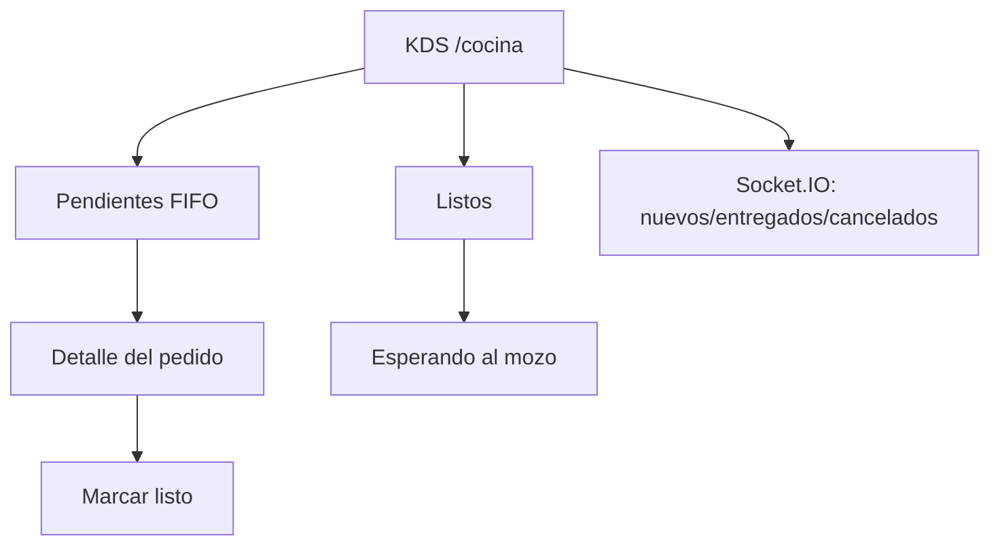

# Plan técnico — Cocina (Pendientes y listos)

## 1. Contexto técnico

| Área | Decisión |
|---|---|
| UI | React + Vite + Tailwind, layout de dos columnas |
| Estado | Zustand (`kitchenStore`) |
| HTTP | Axios con JWT |
| Tiempo real | Socket.IO Client (spec `005`) |
| Pantalla | Tablet/escritorio desde 1024×768 |
| Pruebas | Vitest + React Testing Library + Playwright |

## 2. Constitution Check

| Principio | Cumple | Evidencia |
|---|---|---|
| 1. Spec-first y trazabilidad | Sí | Cada FR tiene tarea. |
| 2. Un solo registro, tres vistas | Sí | Mismo pedido que mozo/encargado. |
| 3. FIFO y una sola acción de cocina | Sí | Solo “Marcar listo”; sin tiempos. |
| 4. Control de raciones y agotados | Sí | Cocina no modifica stock. |
| 5. Trazabilidad y cierre de turno | Sí | `readyBy` registrado. |
| 6. Web responsive y alcance acotado | Sí | Sin pagos, IGV, APK ni tiempos. |

## 3. Arquitectura de UI



## 4. Estructura

```text
client/src/
├── pages/cocina/
│   └── KitchenPage.tsx
├── components/cocina/
│   ├── KitchenHeader.tsx
│   ├── PendingColumn.tsx
│   ├── ReadyColumn.tsx
│   ├── KitchenOrderCard.tsx
│   ├── KitchenItems.tsx
│   ├── KitchenEmptyState.tsx
│   └── KitchenConnectionBanner.tsx
├── stores/
│   └── kitchenStore.ts
├── hooks/
│   └── useKitchenEvents.ts
└── api/
    └── kitchen.api.ts
```

Ruta: `/cocina`, protegida por rol `COCINERO` (y `ENCARGADO` en lectura si se decide).

## 5. Estado

```ts
type KitchenState = {
  pending: Order[];
  ready: Order[];
  loading: boolean;
  error: string | null;
  pendingActionIds: string[];
  fetchBoard: () => Promise<void>;
  applyCreated: (order: Order) => void;
  applyReady: (order: Order) => void;
  applyDelivered: (orderId: string) => void;
  applyCancelled: (orderId: string) => void;
  markReady: (id: string, version: number) => Promise<void>;
  resync: () => Promise<void>;
};
```

Reglas:
- `pending` siempre ordenado por `enviadoEn` ascendente.
- `ready` ordenado por `listoEn` ascendente.
- Un pedido `ENTREGADO`/`CANCELADO` se elimina de ambas columnas.
- `pendingActionIds` evita dobles acciones.
- No actualización optimista del estado; se espera la respuesta/evento.

## 6. Layout

```text
┌──────────────────────────────────────────────────────────────┐
│ COCINA · 3 pendientes · 2 listos · [hora] · [conexión]      │
├───────────────────────────────┬──────────────────────────────┤
│ PENDIENTES (3)                │ LISTOS (2)                   │
│ ┌───────────────────────────┐ │ ┌──────────────────────────┐ │
│ │ Mesa 4 · #42              │ │ │ Mesa 3 · #39             │ │
│ │ 2× Chicharrón             │ │ │ 2× Arroz con mariscos    │ │
│ │   Arroz → papa · Sin ají  │ │ │ Listo para recoger       │ │
│ │ [ Marcar listo ]          │ │ └──────────────────────────┘ │
│ └───────────────────────────┘ │                              │
└───────────────────────────────┴──────────────────────────────┘
```

- Fondo oscuro, alto contraste.
- Cabecera fija con contadores y estado de conexión.
- Tarjetas con mesa, número, ítems, variaciones y notas.
- Variaciones resaltadas; notas legibles.
- Un solo botón por tarjeta pendiente: “Marcar listo”.
- Listos sin botón; solo indicador “Listo para recoger”.
- Sin cronómetros, tiempos transcurridos ni alertas.

## 7. Acción “Marcar listo”

```ts
async function markReady(orderId: string, version: number) {
  if (pendingActionIds.includes(orderId)) return;
  addPending(orderId);
  try {
    const order = await kitchenApi.markReady(orderId, version);
    applyReady(order);
  } catch (error) {
    // 409: refrescar cola
    await resync();
  } finally {
    removePending(orderId);
  }
}
```

- Solo `ENVIADO`.
- `version` evita doble transición.
- Al confirmar, el pedido se mueve a listos.
- El evento `order:ready` avisa al mozo (spec `005`).

## 8. Eventos

- `order:created`: insertar en pendientes por FIFO.
- `order:ready`: mover de pendientes a listos.
- `order:delivered`: quitar de listos.
- `order:cancelled`: quitar de ambas columnas con aviso.
- `connect`: resync.
- `disconnect`: banner.
- Deduplicar por `eventId` y comparar `version`.

## 9. Manejo de errores

| Situación | UI |
|---|---|
| `401` | Login; al volver, resync. |
| `403` | Mensaje de rol. |
| `409` | Aviso y resync. |
| `503` | Banner de servidor no disponible. |
| Socket caído | Banner y resync. |
| Pedido cancelado | Aviso temporal. |

## 10. Legibilidad y accesibilidad

- Tipografía grande y contraste AA.
- Objetivos táctiles ≥ 44 px.
- Scroll independiente por columna.
- `aria-live` para nuevos pedidos y avisos.
- Sin dependencia de sonido.

## 11. Testing

| Nivel | Casos |
|---|---|
| Unitaria | Inserción FIFO, transición, deduplicación. |
| Store | created/ready/delivered/cancelled/resync. |
| Componentes | Tarjeta, columnas, estado vacío. |
| Integración | Marcar listo, `409`, socket. |
| E2E | Mozo envía → KDS → listo → mozo entrega. |
| Manual | 30 pedidos y reconexión. |

## 12. Riesgos

| Riesgo | Mitigación |
|---|---|
| Cola desactualizada | Resync al reconectar. |
| Doble acción | `pendingActionIds` + `version`. |
| 30 pedidos | Scroll y tarjetas compactas. |
| Notas truncadas | Tarjeta expandible. |
| Se agregue “En preparación” | Revisión de alcance. |
| Tiempos | Búsqueda de cronómetros. |

## 13. Fuera de alcance

- “En preparación”.
- Prioridad manual/Kanban drag-and-drop.
- Tiempos/alertas.
- Stock/raciones.
- Entrega/cancelación.
- Pagos/IGV/facturación.
- APK.

## 14. Checklist del plan

- [x] FR cubiertos.
- [x] Constitution Check.
- [x] Contratos referenciados.
- [x] FIFO y acción única.
- [x] Sin tiempos/stock.
- [x] Pruebas planificadas.
