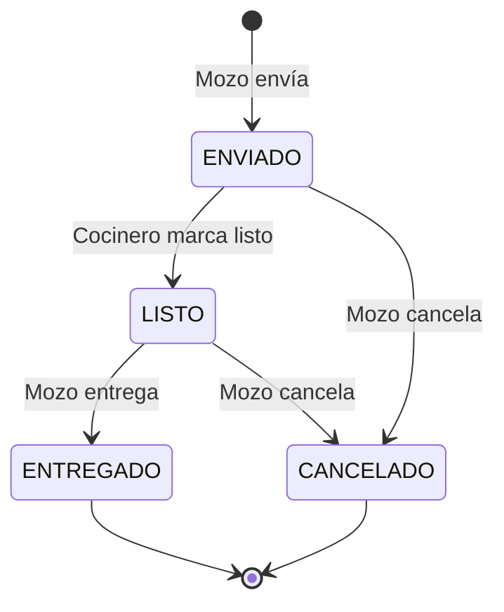

# Especificación — Cocina (Pendientes y listos)

## 1. Contexto y problema

La cocina recibe pedidos sin una cola visible y trabaja con papeles o memoria. El PDF propone una vista de cocina con los pedidos pendientes ordenados por llegada, el detalle completo y un único botón: **“Marcar listo”**. La cocina no marca “En preparación”, no modifica stock ni disponibilidad y no ve tiempos ni alertas de demora.

Esta spec cubre **P-03** y la parte de cocina de **P-04**. No implementa la toma de pedidos (`003`), los avisos (`005`) ni el cierre de turno (`006`).

## 2. Objetivos y no objetivos

### Objetivos

- Mostrar la cola de pedidos pendientes en orden FIFO.
- Mostrar el detalle completo: mesa, platos, cantidades, variaciones y notas.
- Permitir marcar un pedido como `LISTO` con un solo botón.
- Mostrar una columna de pedidos listos hasta que el mozo los entregue o cancele.
- Recibir pedidos nuevos sin recargar.
- Recuperar la cola tras una desconexión.
- Respetar que la cocina no modifica stock ni disponibilidad.

### No objetivos

- No implementa “En preparación”.
- No implementa prioridad manual ni arrastrar y soltar.
- No implementa tiempos, cronómetros ni alertas de demora.
- No implementa modificación de raciones, agotados ni menú.
- No implementa entrega ni cancelación (spec `003`).
- No implementa pagos, IGV, facturación.
- No implementa app nativa/APK.

## 3. Actores y roles

| Actor | Rol | Necesidad principal |
|---|---|---|
| Cocinero | `COCINERO` | Ver qué preparar, en qué orden y marcar listo. |
| Encargado | `ENCARGADO` | Supervisar la cola; sin acciones de cocina. |
| Mozo | `MOZO` | Recibir el aviso y entregar. |
| Sistema | — | Ordenar FIFO y notificar. |

## 4. Historias de usuario

### US-001 — Ver la cola FIFO de pendientes (P1)

**Como** cocinero, **quiero** ver los pedidos pendientes del más antiguo al más reciente, **para** prepararlos en orden de llegada.

**Por qué esta prioridad:** es el corazón de P-03 y RN-06.

**Prueba independiente:** con tres pedidos enviados en momentos distintos, verificar que aparecen en orden FIFO.

**Escenarios de aceptación:**

- **DADO** pedidos `ENVIADO` **CUANDO** abro la cocina **ENTONCES** aparecen ordenados por `enviadoEn` ascendente.
- **DADO** un pedido `LISTO` **CUANDO** consulto pendientes **ENTONCES** no aparece en pendientes.
- **DADO** una cola vacía **CUANDO** abro la cocina **ENTONCES** veo un estado vacío claro.

### US-002 — Ver el detalle completo (P1)

**Como** cocinero, **quiero** ver mesa, platos, cantidades, variaciones y notas, **para** preparar el pedido sin errores.

**Por qué esta prioridad:** las especificaciones incompletas son uno de los problemas del AS-IS.

**Prueba independiente:** abrir un pedido con variaciones y notas y verificar que se ven completas.

**Escenarios de aceptación:**

- **DADO** un pedido con variaciones **CUANDO** se muestra **ENTONCES** se ven resaltadas.
- **DADO** un pedido con notas **CUANDO** se muestra **ENTONCES** se ven sin truncar.
- **DADO** un pedido con muchos ítems **CUANDO** se muestra **ENTONCES** la tarjeta permite scroll sin perder datos.

### US-003 — Marcar listo con un botón (P1)

**Como** cocinero, **quiero** marcar un pedido como listo con un solo toque, **para** avisar al mozo y liberar la cola.

**Por qué esta prioridad:** P-03 y P-04; es la única acción de cocina.

**Prueba independiente:** marcar un pedido `ENVIADO` como `LISTO` y verificar que se mueve a listos y que el mozo recibe el aviso.

**Escenarios de aceptación:**

- **DADO** un pedido `ENVIADO` **CUANDO** presiono “Marcar listo” **ENTONCES** pasa a `LISTO` y se registra `readyBy`.
- **DADO** un doble tap **CUANDO** se procesa **ENTONCES** se registra una sola transición.
- **DADO** un pedido ya listo **CUANDO** intento marcarlo de nuevo **ENTONCES** recibo `409`.
- **DADO** un pedido cancelado **CUANDO** intento marcarlo listo **ENTONCES** recibo `409`.

### US-004 — Ver los pedidos listos (P1)

**Como** cocinero, **quiero** ver los pedidos listos hasta que el mozo los recoja, **para** saber qué está esperando.

**Por qué esta prioridad:** P-04; el pedido no se considera entregado hasta que el mozo lo marca.

**Prueba independiente:** marcar un pedido listo y verificar que aparece en la columna de listos; entregarlo y verificar que desaparece.

**Escenarios de aceptación:**

- **DADO** un pedido `LISTO` **CUANDO** abro la cocina **ENTONCES** aparece en listos.
- **DADO** un pedido `LISTO` **CUANDO** el mozo lo entrega **ENTONCES** desaparece de listos.
- **DADO** un pedido `LISTO` **CUANDO** el mozo lo cancela **ENTONCES** desaparece de listos.

### US-005 — Recibir pedidos nuevos sin refrescar (P1)

**Como** cocinero, **quiero** que los pedidos nuevos aparezcan solos, **para** no dejar pedidos esperando.

**Por qué esta prioridad:** la llegada oportuna es el beneficio principal del KDS.

**Prueba independiente:** con la cocina abierta, enviar un pedido y verificar que aparece en ≤ 2 s.

**Escenarios de aceptación:**

- **DADO** la cocina abierta **CUANDO** el mozo envía un pedido **ENTONCES** aparece sin recargar.
- **DADO** un pedido nuevo **CUANDO** llega **ENTONCES** se resalta visualmente.
- **DADO** un pedido cancelado **CUANDO** llega el evento **ENTONCES** no aparece.

### US-006 — Recuperar la cola tras una desconexión (P1)

**Como** cocinero, **quiero** que la cola se actualice al reconectar, **para** no trabajar con datos viejos.

**Por qué esta prioridad:** la cocina no puede depender de una conexión perfecta.

**Prueba independiente:** desconectar 30 s, crear un pedido y verificar que al reconectar aparece.

**Escenarios de aceptación:**

- **DADO** el socket caído **CUANDO** se reconecta **ENTONCES** la cola se refresca.
- **DADO** un pedido creado durante la caída **CUANDO** se reconecta **ENTONCES** aparece en FIFO.
- **DADO** un pedido entregado durante la caída **CUANDO** se reconecta **ENTONCES** no aparece en listos.

## 5. Requisitos funcionales (EARS)

| ID | Requisito | Fuente | Prioridad |
|---|---|---|---|
| FR-001 | CUANDO un usuario con rol `COCINERO` abre la cocina, EL SISTEMA DEBE mostrar pendientes y listos. | P-03 | P1 |
| FR-002 | CUANDO se consultan pendientes, EL SISTEMA DEBE incluir solo `ENVIADO` y ordenarlos por `enviadoEn` ascendente. | P-03, RN-06 | P1 |
| FR-003 | CUANDO se consultan listos, EL SISTEMA DEBE incluir `LISTO` hasta que se entreguen o cancelen. | P-04, RN-09 | P1 |
| FR-004 | CUANDO se muestra una tarjeta, EL SISTEMA DEBE incluir mesa, ítems, cantidades, variaciones y notas. | P-03 | P1 |
| FR-005 | CUANDO se muestra la cola, EL SISTEMA NO DEBE mostrar tiempos transcurridos, cronómetros ni alertas de demora. | P-03, RN-10 | P1 |
| FR-006 | CUANDO se muestra la cocina, EL SISTEMA NO DEBE ofrecer acciones de “En preparación”, stock o disponibilidad. | P-03, p. 15 | P1 |
| FR-007 | CUANDO el cocinero marca un pedido `ENVIADO` como listo, EL SISTEMA DEBE cambiarlo a `LISTO` y registrar `readyBy`/`listoEn`. | P-03, P-04 | P1 |
| FR-008 | CUANDO el cocinero marca listo, EL SISTEMA DEBE permitirlo con un solo toque y sin confirmación adicional. | P-03 | P1 |
| FR-009 | CUANDO una acción está en curso, EL SISTEMA DEBE deshabilitar el botón para evitar dobles transiciones. | P-03 | P1 |
| FR-010 | CUANDO se crea un pedido, EL SISTEMA DEBE mostrarlo en la cola sin recargar en ≤ 2 s. | P-03, P-04 | P1 |
| FR-011 | CUANDO un pedido se cancela, EL SISTEMA DEBE retirarlo de pendientes y listos y mostrar un aviso. | RN-07 | P1 |
| FR-012 | CUANDO la cocina se reconecta, EL SISTEMA DEBE resincronizar pendientes y listos. | P-03 | P1 |
| FR-013 | EL SISTEMA NO DEBE permitir prioridad manual ni reordenamiento de la cola. | RN-06 | P1 |
| FR-014 | CUANDO se muestra la cabecera, EL SISTEMA DEBE indicar cantidad de pendientes y listos. | P-03 | P2 |
| FR-015 | CUANDO la pantalla es tablet/escritorio, EL SISTEMA DEBE ser legible desde 1024×768. | P-03 | P1 |
| FR-016 | CUANDO hay 30 pedidos, EL SISTEMA DEBE permitir scroll sin degradación perceptible. | P-03 | P1 |
| FR-017 | CUANDO el pedido no está `ENVIADO`, EL SISTEMA DEBE impedir “Marcar listo” con `409`. | P-03, P-04 | P1 |
| FR-018 | CUANDO el pedido se entrega, EL SISTEMA DEBE retirarlo de listos. | P-04 | P1 |
| FR-019 | CUANDO el pedido se cancela estando listo, EL SISTEMA DEBE retirarlo de listos. | P-04 | P1 |
| FR-020 | CUANDO ocurre un error de red, EL SISTEMA DEBE mostrar el estado y permitir reintentar. | P-03 | P1 |
| FR-021 | EL SISTEMA NO DEBE mostrar pagos, IGV, facturación ni costos. | p. 15 | P1 |
| FR-022 | CUANDO la pantalla se abre, EL SISTEMA DEBE usar objetivos táctiles ≥ 44 px. | P-03 | P1 |
| FR-023 | CUANDO el pedido tiene notas largas, EL SISTEMA DEBE mostrarlas completas y legibles. | P-03 | P1 |
| FR-024 | CUANDO el pedido se marca listo, EL SISTEMA DEBE emitir el evento de aviso (spec `005`). | P-04 | P1 |
| FR-025 | CUANDO el usuario lo requiera, EL SISTEMA PUEDE mostrar la hora actual, pero no un temporizador por pedido. | P-03 | P2 |

## 6. Entidades y estados

- `Order`, `OrderItem`, `Table` (ver [`001/data-model.md`](../001-plataforma-base/data-model.md)).
- Pendientes: `ENVIADO`.
- Listos: `LISTO`.
- Terminales: `ENTREGADO`, `CANCELADO`; no aparecen.
- No existe `EN_PREPARACION`.

## 7. Casos borde y errores

| ID | Caso | Comportamiento esperado |
|---|---|---|
| EC-001 | 30 pedidos activos. | Scroll fluido; FIFO visible. |
| EC-002 | Doble tap en “Marcar listo”. | Una sola transición. |
| EC-003 | Pedido cancelado mientras se ve. | Se retira con aviso. |
| EC-004 | Pedido entregado mientras está listo. | Se retira de listos. |
| EC-005 | Socket desconectado. | Banner y resync. |
| EC-006 | Servidor reiniciado. | Cola reconstruida desde MongoDB. |
| EC-007 | Token expirado. | Login; al volver, resync. |
| EC-008 | Pedido con 20 ítems. | Tarjeta con scroll; datos completos. |
| EC-009 | Pantalla pequeña. | Layout responsive; no se exige móvil para cocina. |
| EC-010 | Acción sobre pedido ya listo. | `409`; refresco. |
| EC-011 | Acción sobre pedido cancelado. | `409`; refresco. |
| EC-012 | Hora del dispositivo desviada. | No hay temporizador; solo hora actual del servidor si se muestra. |

## 8. Requisitos no funcionales

| ID | Requisito | Métrica / criterio |
|---|---|---|
| NFR-001 | La cola debe actualizarse rápido. | Nuevo pedido ≤ 2 s. |
| NFR-002 | La acción “Listo” debe ser de un toque. | 100% de pedidos. |
| NFR-003 | La pantalla debe ser legible. | 1024×768 o superior. |
| NFR-004 | La UI debe resistir la jornada. | Sin fugas ni listeners duplicados. |
| NFR-005 | La cola debe soportar 30 pedidos. | Render ≤ 1 s. |
| NFR-006 | No debe haber tiempos ni alertas. | 0 cronómetros. |
| NFR-007 | La reconexión debe ser automática. | Resync ≤ 5 s. |
| NFR-008 | La UI debe ser accesible. | Contraste, foco y textos. |
| NFR-009 | No debe haber acciones de stock. | 0 endpoints de stock en la UI. |

## 9. Criterios de éxito medibles

| ID | Criterio | Cómo se mide |
|---|---|---|
| SC-001 | 100% de pedidos activos en orden FIFO. | 10 pedidos en orden conocido. |
| SC-002 | 100% de pedidos nuevos visibles en ≤ 2 s. | Medición con logs. |
| SC-003 | “Listo” se ejecuta con un toque. | Prueba de usabilidad. |
| SC-004 | 0 transiciones inválidas. | Suite de estados. |
| SC-005 | Cola recuperada en ≤ 5 s tras 60 s desconectado. | Prueba de reconexión. |
| SC-006 | 30 pedidos renderizados en ≤ 1 s. | Medición en navegador. |
| SC-007 | 0 elementos de tiempo, stock o pago. | Revisión de UI/API. |

## 10. Supuestos

- Una sola estación de cocina.
- El estado `LISTO` es por pedido completo, no por ítem.
- La cola se ordena por `enviadoEn`; sin prioridad manual.
- La cocina no modifica stock ni disponibilidad.
- No se muestran tiempos de cocina.
- La pantalla principal es tablet/escritorio; el móvil es secundario.
- Los mockups son referenciales.

## 11. Dependencias y riesgos

| Tipo | Descripción | Mitigación |
|---|---|---|
| Dependencia | `001` provee pedidos y estados. | Contrato congelado. |
| Dependencia | Contrato de eventos de `005` para nuevos pedidos y resync. | Se integra al final; la UI funciona con REST. |
| Riesgo | Pérdida de eventos. | Resync REST. |
| Riesgo | Doble transición. | `version` + botón. |
| Riesgo | Pantalla saturada. | Scroll y 30 pedidos probados. |
| Riesgo | Notas truncadas. | Tarjeta expandible. |
| Riesgo | Se agregue “En preparación”. | Revisión de alcance. |

## 12. Fuera de alcance

- “En preparación”.
- Prioridad manual/Kanban drag-and-drop.
- Tiempos, cronómetros y alertas.
- Stock, raciones y agotados.
- Entrega y cancelación (spec `003`).
- Pagos, IGV, facturación.
- App nativa/APK.

## 13. Preguntas abiertas

| ID | Pregunta | Impacto | Estado |
|---|---|---|---|
| Q-004-01 | ¿Lista de dos columnas o Kanban? | Medio | `[NECESITA ACLARACIÓN]` (se propone dos columnas). |
| Q-004-02 | ¿Se muestra la hora actual? | Bajo | `[NECESITA ACLARACIÓN]` (se propone sí, sin temporizador). |
| Q-004-03 | ¿Se requiere sonido al llegar un pedido? | Bajo | `[NECESITA ACLARACIÓN]` (se propone visual). |
| Q-004-04 | ¿“Listo” es por pedido o por ítem? | Alto | `[NECESITA ACLARACIÓN]` (se propone por pedido). |
| Q-004-05 | ¿Se requiere deshacer/reabrir un pedido listo? | Medio | `[NECESITA ACLARACIÓN]` (fuera de alcance). |
| Q-004-06 | ¿Qué resolución tendrá la pantalla de cocina? | Medio | `[NECESITA ACLARACIÓN]` (se propone 1024×768+). |

## 14. Trazabilidad

| Fuente | Sección | Historias | Requisitos | Criterios |
|---|---|---|---|---|
| PDF p. 9 | P-03 Recibir y preparar | US-001, US-002, US-003 | FR-001–FR-009, FR-013–FR-017 | SC-001–SC-004 |
| PDF p. 9 | P-04 Avisar, recoger y entregar | US-004 | FR-003, FR-018, FR-019, FR-024 | SC-002 |
| PDF p. 11 | RN-06, RN-09, RN-10 | US-001, US-003 | FR-002, FR-005, FR-013 | SC-001, SC-003 |
| PDF p. 15 | Decisiones y alcance | — | FR-006, FR-021, FR-025 | SC-007 |
