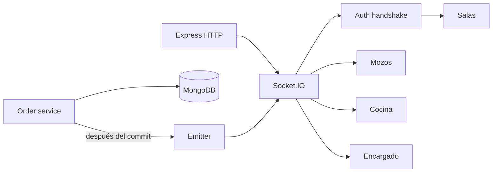

# Plan técnico — Avisos en tiempo real

## 1. Contexto técnico

| Área | Decisión |
|---|---|
| Servidor | Socket.IO sobre el HTTP server de Express |
| Auth | JWT en `handshake.auth.token` |
| Salas | `role:MOZO`, `role:COCINERO`, `role:ENCARGADO`, `user:<id>` |
| Cliente | Singleton + hooks por rol |
| Entrega | At-least-once + dedupe + resync |
| Notificaciones | In-app + sonido; sin push externo |
| Tiempos | Sin eventos de demora |

## 2. Constitution Check

| Principio | Cumple | Evidencia |
|---|---|---|
| 1. Spec-first y trazabilidad | Sí | Contrato y FR mapeados. |
| 2. Un solo registro, tres vistas | Sí | Eventos del mismo pedido. |
| 3. FIFO y una sola acción de cocina | Sí | Sin eventos de inicio/tiempo. |
| 4. Control de raciones y agotados | Sí | `menu:availability-changed`. |
| 5. Trazabilidad y cierre de turno | Sí | `order:*`, `shift:closed`. |
| 6. Web responsive y alcance acotado | Sí | Sin push, pagos, IGV ni tiempos. |

## 3. Arquitectura



## 4. Estructura

```text
server/src/
├── realtime/
│   ├── socket.ts
│   ├── emitter.ts
│   ├── rooms.ts
│   └── envelope.ts
├── services/
│   ├── order.service.ts
│   ├── order-transition.service.ts
│   └── menu.service.ts
└── server.ts
```

```text
client/src/
├── api/socket.ts
├── hooks/
│   ├── useRealtimeConnection.ts
│   ├── useOrderEvents.ts
│   └── useKitchenEvents.ts
├── stores/notificationsStore.ts
└── utils/eventDedupe.ts
```

## 5. Autenticación y salas

```ts
io.use((socket, next) => {
  const token = socket.handshake.auth?.token;
  if (!token) return next(new Error('UNAUTHORIZED'));
  try {
    const user = verifyJwt(token);
    socket.data.user = user;
    next();
  } catch (error) {
    next(new Error(error.code ?? 'UNAUTHORIZED'));
  }
});

io.on('connection', (socket) => {
  const { id, role } = socket.data.user;
  socket.join(`user:${id}`);
  socket.join(`role:${role}`);
});
```

- Todos los mozos entran a `role:MOZO`.
- No hay suscripción manual a salas.

## 6. Emisión

| Acción | Evento | Salas |
|---|---|---|
| Crear pedido | `order:created` | `role:COCINERO`, `role:MOZO`, `role:ENCARGADO` |
| Marcar listo | `order:ready` | `role:MOZO`, `role:COCINERO`, `role:ENCARGADO` |
| Entregar | `order:delivered` | `role:COCINERO`, `role:MOZO`, `role:ENCARGADO` |
| Cancelar | `order:cancelled` | `role:COCINERO`, `role:MOZO`, `role:ENCARGADO` |
| Cierre manual | `order:manual-closed` | `role:COCINERO`, `role:MOZO`, `role:ENCARGADO` |
| Raciones/agotado | `menu:availability-changed` | `role:MOZO`, `role:ENCARGADO`, `role:COCINERO` |
| Cerrar turno | `shift:closed` | todas |

- Emitir después del commit.
- Si falla la emisión, no revertir; registrar `EMIT_FAILED`.
- No emitir eventos de tiempo/pago.

## 7. Envelope

```ts
function buildEnvelope(type, payload, version, orderId = null) {
  return {
    eventId: randomUUID(),
    type,
    occurredAt: new Date().toISOString(),
    version,
    schemaVersion: 2,
    orderId,
    payload
  };
}
```

## 8. Cliente

- Singleton con token.
- `useRealtimeConnection` expone `connected/disconnected/error`.
- `useOrderEvents` para mozo; `useKitchenEvents` para cocina.
- `notificationsStore` con `eventId` y badge.
- Sonido con `Audio`/Web Audio; se desbloquea con interacción; fallback visual.
- Al reconectar:
  - Mozo: `GET /api/orders?scope=active` y `GET /api/menu/today`.
  - Cocina: `GET /api/kitchen/board`.
  - Encargado: resumen/cola.

## 9. Deduplicación y orden

- `Set<eventId>` por pestaña.
- Comparar `version` con el estado actual.
- Si el pedido no existe, consultar por REST.
- No replay.

## 10. Notificaciones

- `order:ready`: toast, badge y sonido a todos los mozos.
- `menu:availability-changed`: actualizar menú y toast si `AGOTADO`.
- `order:cancelled`: aviso y retiro.
- `shift:closed`: bloquear nuevas operaciones.
- Sin alertas de tiempo.

## 11. Seguridad

- JWT en handshake.
- CORS.
- Salas del servidor.
- No datos sensibles.
- Rate limit de conexiones (opcional).

## 12. Testing

| Nivel | Casos |
|---|---|
| Unitaria | Envelope, dedupe, orden. |
| Integración | Handshake, salas, eventos. |
| Cliente | Hooks, store, toast. |
| E2E | Mozo + cocina en dos contextos. |
| Carga | 20 clientes, 100 eventos. |

## 13. Riesgos

| Riesgo | Mitigación |
|---|---|
| Pérdida de eventos | Resync. |
| Duplicados | `eventId`. |
| Fuera de orden | `version`. |
| Fuga de roles | Salas y pruebas. |
| Emisión antes del commit | Emitir después del `await`. |
| Escalado | Redis adapter futuro. |
| Token expirado | Login. |

## 14. Fuera de alcance

- Push del sistema operativo.
- Redis adapter.
- Replay.
- Chat/presencia.
- Tiempos/alertas.
- Pagos/IGV.

## 15. Checklist del plan

- [x] Contrato completo.
- [x] Auth y salas.
- [x] Emisión mapeada.
- [x] Resync y dedupe.
- [x] Sin push externo ni tiempos.
- [x] Pruebas planificadas.
