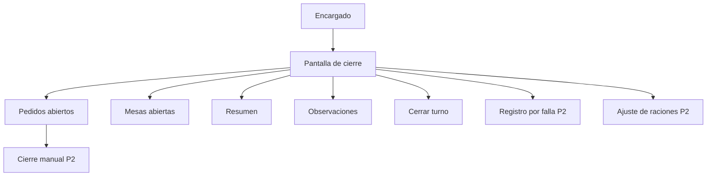

# Plan técnico — Cierre de turno

## 1. Contexto técnico

| Área | Decisión |
|---|---|
| UI | React + Vite + Tailwind, tablet/escritorio |
| Estado | Zustand (`shiftCloseStore`) |
| HTTP | Axios con JWT |
| Resumen | Snapshot en `shiftSummaries` |
| Pruebas | Vitest + React Testing Library + Supertest |

## 2. Constitution Check

| Principio | Cumple | Evidencia |
|---|---|---|
| 1. Spec-first y trazabilidad | Sí | Cada FR tiene tarea. |
| 2. Un solo registro, tres vistas | Sí | Resumen desde pedidos/raciones. |
| 3. FIFO y una sola acción de cocina | Sí | No agrega acciones de cocina. |
| 4. Control de raciones y agotados | Sí | Incluye raciones/agotados y ajustes. |
| 5. Trazabilidad y cierre de turno | Sí | Snapshot, actor y motivo. |
| 6. Web responsive y alcance acotado | Sí | Sin pagos, IGV, exportación ni APK. |

## 3. Arquitectura de UI



## 4. Estructura

```text
client/src/
├── pages/encargado/
│   └── ShiftClosePage.tsx
├── components/cierre/
│   ├── OpenOrdersList.tsx
│   ├── OpenTablesList.tsx
│   ├── SummaryCards.tsx
│   ├── SoldDishesTable.tsx
│   ├── RemainingRationsTable.tsx
│   ├── SoldOutList.tsx
│   ├── CancellationsTable.tsx
│   ├── ObservationForm.tsx
│   ├── CloseShiftButton.tsx
│   ├── ManualCloseModal.tsx
│   ├── ManualRecordForm.tsx
│   └── AdjustRationsModal.tsx
├── stores/
│   └── shiftCloseStore.ts
└── api/
    └── shiftClose.api.ts
```

Ruta: `/encargado/cierre`, rol `ENCARGADO`.

## 5. Flujo

1. Cargar turno actual, pedidos abiertos y mesas abiertas.
2. Mostrar resumen en vivo.
3. Resolver pendientes:
   - Entregar/cancelar pedidos.
   - Cerrar mesas.
   - Cierre manual P2.
4. Registrar observaciones.
5. Cerrar turno.
6. Guardar snapshot y emitir `shift:closed`.
7. Bloquear nuevas operaciones.

## 6. Estado

```ts
type ShiftCloseState = {
  shift: Shift | null;
  openOrders: Order[];
  openTables: TableSession[];
  summary: ShiftSummary | null;
  observations: string;
  loading: boolean;
  error: string | null;
  load: () => Promise<void>;
  closeTable: (id: string) => Promise<void>;
  manualCloseOrder: (id: string, reason: string) => Promise<void>;
  addManualRecord: (payload: ManualRecordInput) => Promise<void>;
  adjustRations: (menuItemId: string, value: number, reason: string) => Promise<void>;
  closeShift: (observations: string) => Promise<void>;
};
```

## 7. Resumen

- `soldDishes`: agrupa ítems de pedidos `ENTREGADO` por plato; cantidad y monto informativo.
- `remainingRations`: de `menuItems` del día.
- `soldOutDishes`: `manuallySoldOut` o `remainingRations=0`.
- `cancellations`: pedidos `CANCELADO` con motivo.
- `manualRecords`: registros `PAPER`.
- `totalAmountCents`: suma informativa.
- `observations`.
- `closedAt`.

**No** incluye pagos, IGV, propinas ni cierre de caja.

## 8. Validaciones

- No cerrar turno con pedidos `ENVIADO`/`LISTO`.
- No cerrar turno con mesas abiertas.
- No cerrar turno ya cerrado.
- Cierre manual: motivo obligatorio.
- Registro manual: mesa, al menos un ítem, cantidades > 0.
- Ajuste de raciones: entero ≥ 0, motivo obligatorio.
- No exportar a Excel/PDF en el MVP.

## 9. Manejo de errores

| Situación | UI |
|---|---|
| `OPEN_ORDERS_REMAIN` | Lista de pedidos. |
| `OPEN_TABLES_REMAIN` | Lista de mesas. |
| `409` turno cerrado | Refrescar. |
| `422` validación | Mensajes por campo. |
| `401` | Login. |
| `503` | Reintento. |

## 10. Testing

| Nivel | Casos |
|---|---|
| Unitaria | Resumen, agrupación, validaciones. |
| Integración | Cierre, pendientes, snapshot. |
| Componentes | Tablas, formularios, modales. |
| E2E | Operar → cerrar mesas → cerrar turno. |
| Manual | Turno con cancelaciones y agotados. |

## 11. Riesgos

| Riesgo | Mitigación |
|---|---|
| Cierre con pendientes | `409` y listado. |
| Resumen desactualizado | Snapshot. |
| Registro manual duplicado | Advertencia. |
| Confusión con caja | Etiqueta informativa. |
| Exportación no disponible | Fuera del MVP. |
| Ajuste negativo | Validación. |

## 12. Fuera de alcance

- Cobro, pagos, IGV, facturación.
- Cierre de caja/contabilidad.
- Exportación Excel/PDF.
- APK.
- Tiempos de cocina.
- Delivery/inventario.

## 13. Checklist del plan

- [x] FR cubiertos.
- [x] Constitution Check.
- [x] Contrato referenciado.
- [x] Snapshot y validaciones.
- [x] Pruebas planificadas.
- [x] Sin pagos/IGV/exportación.
