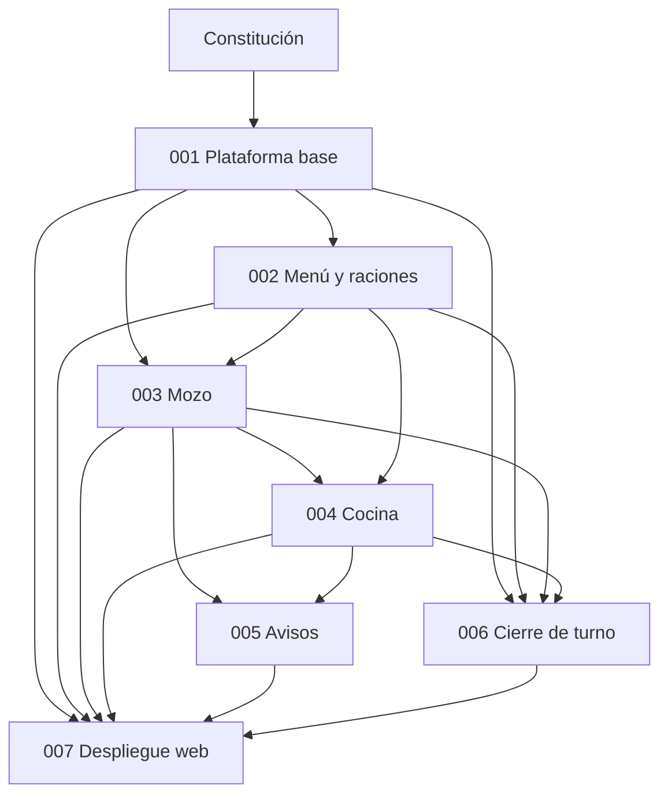

# Índice de especificaciones — Cevichería Lucy v2

Este directorio agrupa las specs por feature, siguiendo SDD. La fuente es `docs/sources/DOCUMENTO_PROCESOS_CEVICHERIA_LUCY.pdf`.

## 1. Estado de las specs

| # | Feature | Procesos | Prioridad | spec | plan | tasks | checklist | Otros |
|---|---|---|---|---|---|---|---|---|
| 001 | [Plataforma base](001-plataforma-base/spec.md) | Actores, estados | P1 | ✅ | ✅ | ✅ | ✅ | `data-model.md`, `research.md`, `quickstart.md`, `contracts/rest-api.md` |
| 002 | [Menú y raciones](002-menu-raciones/spec.md) | P-01, P-05 | P1 | ✅ | ✅ | ✅ | ✅ | `research.md`, `quickstart.md` |
| 003 | [Toma de pedidos — Mozo](003-toma-pedidos-mozo/spec.md) | P-02, P-04 | P1 | ✅ | ✅ | ✅ | ✅ | `quickstart.md` |
| 004 | [Cocina — Pendientes y listos](004-cocina-pendientes/spec.md) | P-03, P-04 | P1 | ✅ | ✅ | ✅ | ✅ | `quickstart.md` |
| 005 | [Avisos en tiempo real](005-avisos-tiempo-real/spec.md) | P-04, P-05 | P1 | ✅ | ✅ | ✅ | ✅ | `research.md`, `quickstart.md`, `contracts/events.md` |
| 006 | [Cierre de turno](006-cierre-turno/spec.md) | P-06 | P1 | ✅ | ✅ | ✅ | ✅ | `research.md`, `quickstart.md` |
| 007 | [Despliegue web responsive](007-despliegue-web-responsive/spec.md) | Web | P1 | ✅ | ✅ | ✅ | ✅ | `research.md`, `quickstart.md` |

## 2. Dependencias

- `001` es la base compartida.
- `002` es la fuente de disponibilidad y raciones.
- `003` y `004` pueden avanzar en paralelo después de `001` y `002`.
- `005` es transversal a `003` y `004`.
- `006` consume pedidos, raciones y turnos.
- `007` cierra el despliegue.

## 3. Trazabilidad al PDF

| PDF | Sección / proceso | Specs |
|---|---|---|
| p. 3 | Resumen ejecutivo | 001, 002, 003, 004 |
| p. 4 | Situación actual y problemas | 001, 003, 004, 006 |
| p. 5 | Solución propuesta | 001, 002, 003, 004, 005 |
| p. 6 | Actores y responsabilidades | 001, 002, 003, 004, 006 |
| p. 7 | **P-01** Configurar menú, raciones y variaciones | 002 |
| p. 8 | **P-02** Tomar y enviar el pedido | 003 |
| p. 9 | **P-03** Recibir y preparar | 004 |
| p. 9 | **P-04** Avisar, recoger y entregar | 003, 004, 005 |
| p. 10 | **P-05** Controlar raciones y agotados | 002, 006 |
| p. 10 | **P-06** Cerrar el turno | 006 |
| p. 11 | **RN-01 a RN-12** Reglas de negocio | 002, 003, 004, 006 |
| pp. 12-13 | Estados del pedido y del plato | 001, 002, 003, 004 |
| p. 14 | Flujo general | 001, 003, 004, 005 |
| p. 15 | Glosario y decisiones | 001, 007 |

## 4. Decisiones transversales

| Decisión | Documento canónico |
|---|---|
| Roles y permisos | `001-plataforma-base/spec.md` |
| Modelo de datos MongoDB | `001-plataforma-base/data-model.md` |
| Estados del pedido y del plato | `001-plataforma-base/data-model.md` |
| Contrato REST | `001-plataforma-base/contracts/rest-api.md` |
| Contrato de eventos Socket.IO | `005-avisos-tiempo-real/contracts/events.md` |
| Stack y arquitectura | `001-plataforma-base/plan.md` |
| Despliegue web | `007-despliegue-web-responsive/plan.md` |

## 5. Decisiones de negocio confirmadas

| Tema | Decisión |
|---|---|
| Aviso “Listo” | Todos los mozos lo reciben; cualquiera puede entregar. |
| Raciones | El mozo repone; el encargado marca agotado/ajusta con motivo. |
| Cancelación | Permitida en Borrador, Enviado y Listo; en Listo se advierte coordinar con cocina. |
| Raciones al cancelar | Se reponen en Enviado; no en Listo. |
| Mesas | Cierre manual por mozo/encargado. |
| Turno | Configurable; el encargado abre y cierra. |
| Cierre manual y registro por falla | P2 dentro de `006`. |
| Alcance | Sin SUNAT, sin APK, sin pagos; PWA opcional. |

## 6. Preguntas abiertas prioritarias

| ID | Pregunta | Spec | Impacto |
|---|---|---|---|
| Q-001-01 | ¿El turno se abre manualmente o se crea al primer pedido? | 001 | Medio |
| Q-001-02 | ¿Se registrarán comensales por mesa? | 001/003 | Bajo |
| Q-002-01 | ¿Las raciones son por día o por turno? | 002 | Alto |
| Q-002-02 | ¿Se permite reponer por encima del total preparado? | 002 | Medio |
| Q-003-02 | ¿Cualquier mozo puede cancelar cualquier pedido? | 003 | Medio |
| Q-004-04 | ¿“Listo” es por pedido o por ítem? | 004 | Alto |
| Q-005-01 | ¿Se requerirá push del sistema operativo en el futuro? | 005 | Medio |
| Q-006-01 | ¿El resumen de cierre incluye montos además de cantidades? | 006 | Medio |
| Q-006-02 | ¿El registro por falla afecta raciones o solo el resumen? | 006 | Medio |
| Q-007-01 | ¿Dónde se desplegará la demo? | 007 | Alto |

El detalle completo está en la sección 13 de cada spec.

## 7. Estado de una spec

| Estado | Significado |
|---|---|
| `borrador` | Escrita, pendiente de revisión del negocio. |
| `revisada` | Revisada; preguntas no bloqueantes aceptadas. |
| `aprobada` | Aprobada para planificación/implementación. |
| `implementada` | Implementada y verificada. |

Todas las specs están en `borrador` a la fecha de creación.
